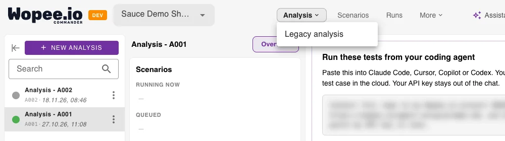
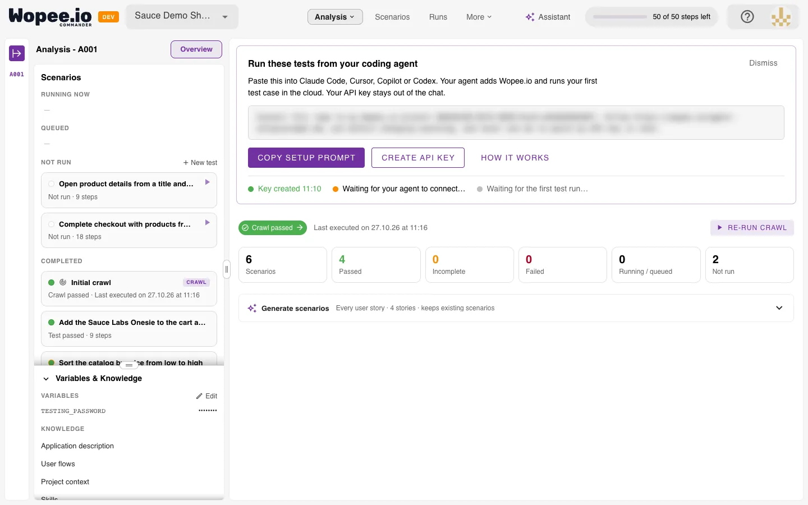
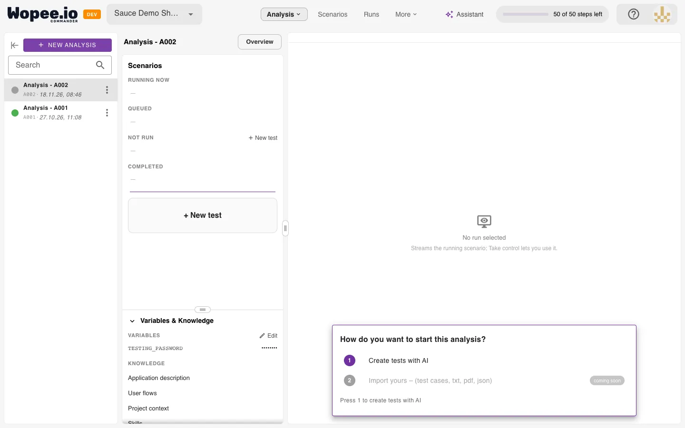
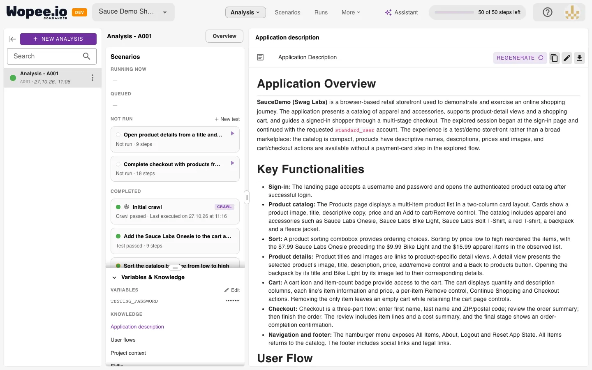
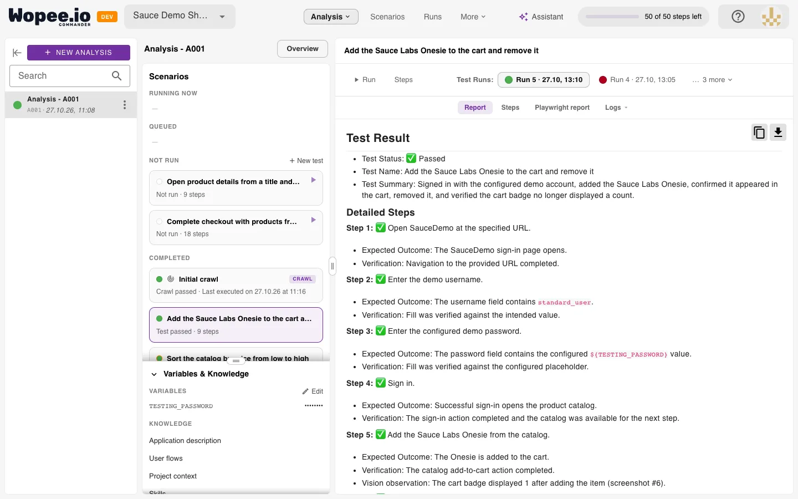
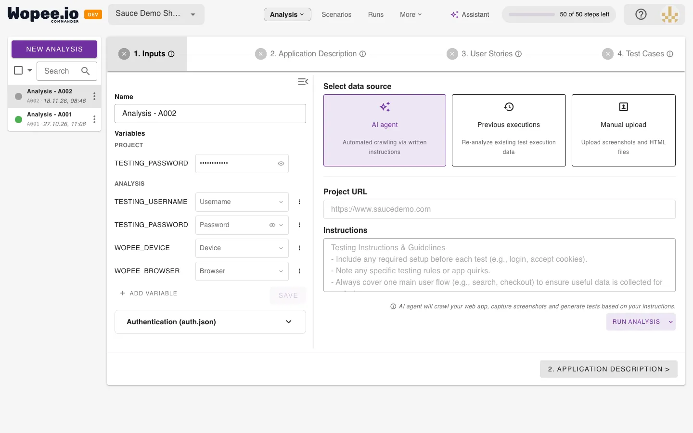
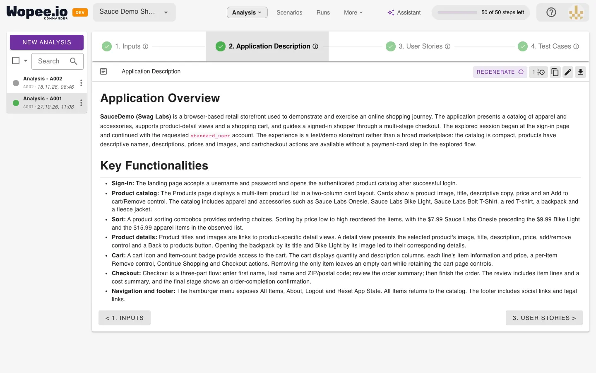
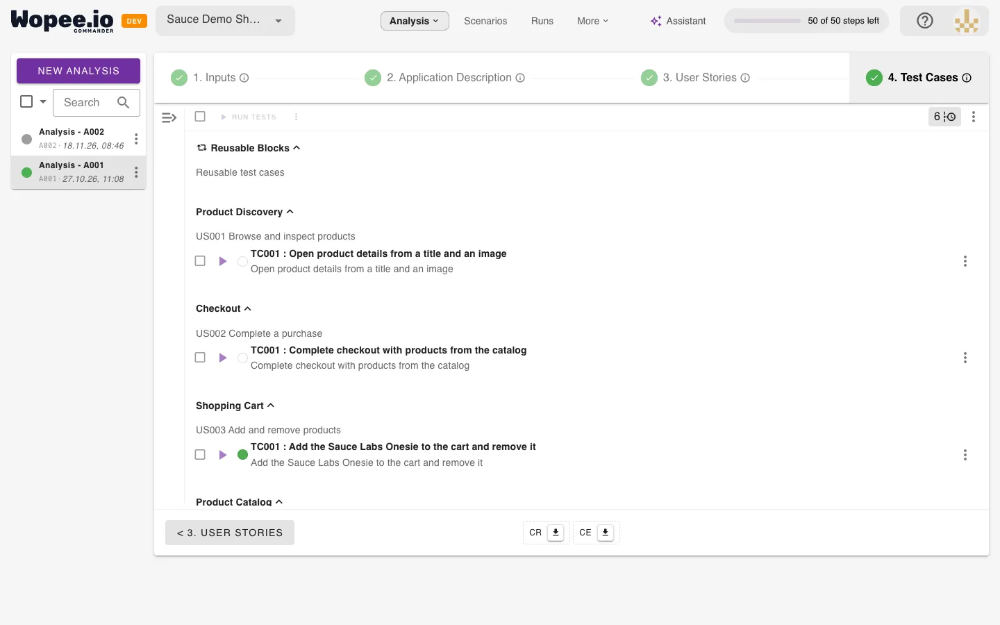

# Analysis Process

An analysis is where the testing agent explores your app and turns what it finds into tests you can run. Every analysis goes through the same stages:

1. **Crawl.** The agent opens your project URL in a real browser, clicks through the app and captures screenshots and HTML.
2. **Application description.** From what the agent saw, Wopee.io writes a description of the app: its features, key pages and the values it shows.
3. **User flows.** The description becomes user flows, written as user stories with acceptance criteria.
4. **Scenarios.** Each user story becomes one or more scenarios (test cases) with their steps.
5. **Runs.** The agent runs the scenarios against your app and reports a verdict for each: Passed, Failed or Incomplete. See [Verdict Integrity](verdict-integrity.md).

Each stage builds on the one before. You can edit the application description and the user flows, and generate scenarios again, without crawling again.

Commander has two views of the same analyses:

- **[The analysis workspace](#analysis-workspace)**, the default view. One screen with the live agent, the scenario board and the analysis overview.
- **[The legacy analysis view](#legacy-analysis)**, a stepper with four steps: **1. Inputs**, **2. Application Description**, **3. User Stories**, **4. Test Cases**. It has a few options the workspace does not, such as crawl instructions, uploaded screenshots and publishing tests to Git.

## Switch between the two views { #switch-views }

Both views show the same analyses, user flows, scenarios and runs. An analysis started in one view opens in the other.

- **To the legacy view:** hover **Analysis** in the top bar and choose **Legacy analysis**.
- **Back to the workspace:** hover **Analysis** and choose **New analysis**.

{ width="1000" height="280" loading="lazy" }

Commander remembers your choice for each project, in this browser. On another browser or computer, the project opens in the default view again. Some installations open the legacy view by default; the menu switches both ways there too.

### Which view do you need? { #which-view }

| You want to | Workspace | Legacy view |
| --- | --- | --- |
| Watch the agent explore, take control, answer its questions | Yes, in the **Live** stage | Yes, with **Run interactively** |
| Crawl without a live view | No | Yes, with **Run analysis** |
| Give the crawl written instructions for this analysis | No, use the [project context](../guides/project-context.md) | Yes, in **Instructions** |
| Generate tests from an earlier crawl or from uploaded screenshots and HTML | No | Yes, **Previous executions** or **Manual upload** |
| Edit the application description and user flows | Yes | Yes, with version history |
| Generate scenarios with extra instructions | Yes | Yes |
| Write a scenario by hand | Yes, **+ New test** | Yes, **Add test case** |
| See the results of an analysis at a glance | Yes, in **Overview** | No |
| Publish tests to Git (push or pull request) | No | Yes, **Publish tests** |
| Download or upload test cases as JSON | No | Yes |

## The analysis workspace { #analysis-workspace }

The workspace has three columns:

- **The analysis list**, collapsed to a narrow rail. Click an analysis ID (such as `A001`) to open it, or expand the rail for **+ New analysis**, **Search** and each analysis's ⋮ menu (**Stop**, **Rename**, **Duplicate**, **Delete**).
- **The analysis**: its name, **Overview**, the **Scenarios** board and **Variables & Knowledge**.
- **The detail panel** on the right: the live browser, the overview, a scenario's steps or a run's report.

{ width="1440" height="900" loading="lazy" }

### Start an analysis { #workspace-start }

1. Expand the analysis list and click **+ New analysis**. Commander creates an empty analysis named `Analysis - A00x` straight away.
2. In **How do you want to start this analysis?**, choose **Create tests with AI**, or press `1`. The crawl starts at once.

{ width="1440" height="900" loading="lazy" }

The workspace has no form before the crawl. The agent starts at the project URL and uses the project's variables. So before you start:

- **Check the project URL** in the project settings, and that the agent can reach it: [Can the agent reach your app?](../guides/test-localhost.md)
- **Add a test account** if the app has a sign-in: `TESTING_USERNAME` and `TESTING_PASSWORD`, see [Test an app behind a login](../first-green-test/test-behind-a-login.md).
- **Put lasting rules in the [project context](../guides/project-context.md)**: how to sign in, cookie banners, areas to stay out of. The agent reads it on every crawl and run.

!!! note "Free plan"
    On the free plan, a crawl uses the testing agent's steps. Only your first analysis is free. See the note at the top of [Troubleshooting: Commander](../troubleshooting/commander.md).

### Watch and steer the live agent { #workspace-live }

While the agent explores, the **Live** stage streams its browser. The live steps show what it is doing, for example Exploring, Following direction, Needs input, Building scenarios or Generating tests.

- **Take control** pauses the agent after its current action and hands you the browser, for example to solve a CAPTCHA or enter a one-time code. Click **Hand back to agent** or **Resume agent** when you are done, and add a note if the agent should know what you did.
- **Agent needs your input** appears when the agent asks a question. Answer it in the chat, or pick one of the suggested answers.
- You can write to the agent at any time, for example to point it to a part of the app it missed.

!!! warning "No passwords in the chat"
    Type passwords in the browser, or save them as variables. Never send them in the chat.

What you do in the live browser helps only this crawl. Every later run starts in a fresh browser.

### What gets generated { #workspace-generation }

When the agent has finished exploring, Wopee.io generates, in this order:

- **Application description**
- **User flows**
- **Scenarios**
- **Steps** for each scenario

**Overview** shows each one as Queued, Generating…, Ready, Failed or Skipped. Scenarios usually take 20 to 35 seconds per user story.

After the crawl, up to 4 scenarios run straight away: up to 3 that are most likely to find a bug, plus one main flow the agent completed while exploring. The others wait under **NOT RUN**. See [Read your first results](../first-green-test/read-your-first-results.md).

!!! tip "Crawls can teach the agent"
    When the project's Agent Skills mode is **Auto-update**, a finished crawl can save what the agent learned about your app as a skill in the project repository. The scenarios that run after the crawl go through their own queue, always one by one, even when the project's Run Queue is **Parallel**. Interactive runs on Wopee.io's pre-warmed runners, such as a live crawl and these scenarios, do not read the repository and run without skills. See [Agent Skills and Run Queue](agent-skills.md).

### Overview { #workspace-overview }

Click **Overview** to see the analysis at a glance:

- **The crawl status**: Crawling, Generating, Crawled or the crawl's verdict. Click it to open the crawl's report and logs.
- **The counters**: **Scenarios**, **Passed**, **Incomplete**, **Failed**, **Running / queued** and **Not run**.
- **Re-run crawl** explores the app again and refreshes the screenshots and the report. Your scenarios, their steps and their run history are kept.
- **Stop analysis** and **Stop scenario runs** stop the crawl or the queued runs.
- **Generate scenarios**, described below.

### Generate scenarios { #workspace-generate-scenarios }

Open **Generate scenarios** on the overview to write new scenarios or improve the existing ones:

- **Scope:** **Every user story**, or the user stories you pick.
- **Additional instructions:** a focus for this generation, for example "add coverage for checkout with an expired card". They are saved for this analysis and sent with every later generation in it.
- **Keep existing scenarios** (on by default): the generator evolves the current scenarios. They keep their steps and run history unless your instructions name them. Turn it off to replace all scenarios in the scope; Commander asks you to confirm.
- **Rebuild the story outline** rebuilds the list of user stories and scenario titles from the application description.

Click **Generate scenarios**. The card shows how many stories it writes and roughly how long it takes.

### Variables & Knowledge { #workspace-knowledge }

**Variables & Knowledge** sits below the scenario board.

- **Variables:** click **Edit** to set variables for this analysis only. A variable with the same name as a project variable overrides it. The built-in ones are `TESTING_USERNAME`, `TESTING_PASSWORD`, `WOPEE_DEVICE` and `WOPEE_BROWSER`. You can also upload an **Authentication (auth.json)** file, see [Browser local storage](../guides/browser-local-storage.md).
- **Application description** and **User flows** open in the panel on the right. Edit, copy or download them, or click **Regenerate**. A regenerated text replaces your edits; Commander keeps the previous version in this browser, so you can click **Restore previous version** right after.
- **Project context** and **Skills** open the project settings.

{ width="1440" height="900" loading="lazy" }

Generated scenarios take concrete values such as prices and limits from the application description first. After you change values there, generate the scenarios again.

### Scenarios and runs { #workspace-scenarios }

The **Scenarios** board groups the scenarios of the analysis into **RUNNING NOW**, **QUEUED**, **NOT RUN** and **COMPLETED**. The **Initial crawl** card is the crawl itself.

- **Run a scenario:** click ▶ on its card, or open it and click **Run**. Interactive mode is on, so you can watch the run live. If the scenario has no steps yet, **Save steps from this run** stores the steps the agent takes.
- **Read a result:** open a scenario. **Test Runs** lists its runs; each has a **Report** with the verdict and every step, **Steps**, **Playwright report** and **Logs**. See [Read your first results](../first-green-test/read-your-first-results.md).
- **Edit steps:** in **Steps**, click **Edit**, change the steps and click **Save**.
- **Write a scenario by hand:** click **+ New test**, give it a name and a description, click **Create** and add its steps. Hand-written scenarios are filed under the user story "Manually added scenarios".

{ width="1440" height="900" loading="lazy" }

Your edits are saved to the project's repository. To run the scenarios outside Commander, see [Run in CI](../ci/index.md).

## The legacy analysis view { #legacy-analysis }

The legacy view takes you through an analysis in four steps. Open it with **Analysis** › **Legacy analysis**. The left column lists the analyses, with **New analysis**, **Search** and a selection menu to stop, duplicate or delete several at once.

Every step has an ⓘ icon with a short description. Move between steps with the step names at the top or the buttons at the bottom.

### 1. Inputs { #legacy-inputs }

Click **New analysis**. Commander creates an empty analysis and opens **1. Inputs**.

{ width="1440" height="900" loading="lazy" }

**The side panel** on the left holds the analysis settings:

- **Name** of the analysis.
- **Variables:** the project variables (read only) and the variables for this analysis. Fill in `TESTING_USERNAME` and `TESTING_PASSWORD` here to sign in with a different test account than the project's, and `WOPEE_DEVICE` and `WOPEE_BROWSER` to pick the device and browser. **Add variable** adds your own. Click **Save**.
- **Authentication (auth.json):** a saved browser session, see [Browser local storage](../guides/browser-local-storage.md).

**Select data source** decides where the screenshots and HTML for the analysis come from:

- **AI agent** (the default): the agent crawls your app.
    - **Project URL** shows where it starts. To change it, edit the project settings.
    - **Instructions** tell the agent what it needs for this analysis: setup before each test such as signing in or accepting cookies, rules and quirks of the app, and the main user flow to cover. The agent also receives them on every run of this analysis.
    - **Run analysis** crawls in the background, without a live view.
    - **Run analysis** ▾ › **Run interactively** opens the **Live Cockpit**: you watch the agent's browser, can **Take control** and **Resume agent**, and send it messages. Click **Done** to end it. Only an interactive crawl runs the first scenarios automatically when it ends.
- **Previous executions:** reuse the screenshots and results of an earlier crawl. Choose it in **Select a suite** and click **Analyze existing**. Available once the project has a crawled analysis.
- **Manual upload:** upload screenshots (`.png`) and the matching HTML (`.html`), for example mockups or Figma exports, and click **Upload & analyze**.

After the crawl, step 1 shows the screenshots and the agent's report. **Re-run analysis** drops the screenshots and captures new ones; the existing test cases are not affected.

### 2. Application Description { #legacy-application-description }

The description of your app, generated from the screenshots and HTML.

{ width="1440" height="900" loading="lazy" }

- **Edit**, copy or download it. Clear wording and correct values here lead to better user stories and test cases.
- **Regenerate** writes it again from the crawl data and overwrites your edits; Commander asks you to confirm.
- **Version history:** every change is a commit in the project's repository. Pick an earlier version, compare it with the current one and click **Restore this version** to go back.

### 3. User Stories { #legacy-user-stories }

The user flows of your app, written as user stories (_As a [role], I want to [action], so I can [goal]_) with acceptance criteria.

- **Edit** the stories to change roles, actions or goals, or to add and remove stories.
- Open the side drawer for **Additional instructions**, for example "focus on the checkout and account flows", and click **Regenerate**. Regenerating overwrites the current stories; Commander asks you to confirm.
- The same version history as in step 2.

### 4. Test Cases { #legacy-test-cases }

The test cases, grouped by category and user story.

{ width="1440" height="900" loading="lazy" }

**Generate test cases.** Open the side drawer:

- **Scope:** **Every user story**, or the user stories you pick.
- **Additional instructions:** a focus for this generation. They are saved for this analysis and sent with every generation in it.
- **Keep existing test cases** (on by default once test cases exist): evolve the current test cases instead of replacing them. Commander asks before it replaces them.
- **Generate test cases** writes the test cases; the drawer shows how many stories it writes and roughly how long it takes.
- **Rebuild the story outline** rebuilds the list of user stories and test case titles from the application description.

With no test cases yet, the step offers **Generate test cases**, **Add user story** and **Upload JSON**.

**Edit and organise.** Each user story has **Edit user story**, **Delete user story** and **Add test case**. Each test case has a ⋮ menu with **Edit**, **Duplicate**, **Delete** and **Stop/Dequeue**.

**Run.** Click ▶ next to a test case, or select several and click **Run tests**. The run dialog has two switches:

- **Save steps from this run** (on): when the test case has no steps yet, the agent's steps are saved to it.
- **Interactive mode** (off): watch the run live and take control.

The selection menu next to **Run tests** also has **Re-run test cases via code**, which replays the generated Playwright code instead of the agent, **Generate steps**, **Stop/Dequeue**, **Duplicate** and **Delete**. **Stop queue** stops every queued run.

**Publish to Git.** Open the ⋮ menu at the top right:

- **Publish tests** commits the test cases to the project's repository. Only test cases that have generated code and a finished run can be published; run the others first. Choose **Push** or **Pull request** and the **Target branch**, and click **Publish**.
- **Download JSON** and **Upload JSON** export or import the test cases.

The history icon at the top right lists earlier versions of the test cases, which you can restore.

## Related

- [Analysis - Inputs](analysis-inputs.md): user stories, Jira and Figma as inputs for test generation
- [Project context](../guides/project-context.md): rules every analysis and run follows
- [Intent & Scripted Tests](intent-and-scripted-tests.md): how a scenario's description and steps are used in a run
- [Agent Skills and Run Queue](agent-skills.md): skills the agent reads and writes, and how tests started together are queued
- [Troubleshooting: Commander](../troubleshooting/commander.md): failed crawls and other messages
