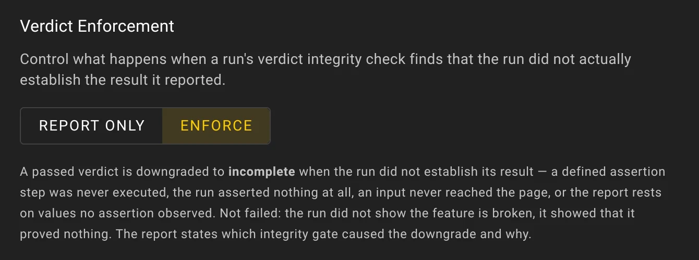
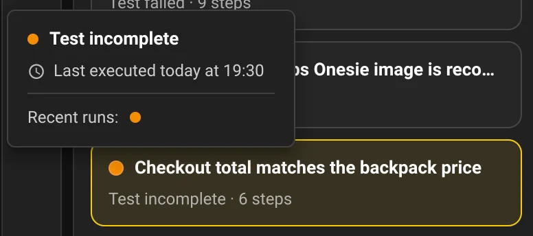

# Verdict Integrity

Verdict integrity is how Wopee.io makes sure a **Passed** verdict rests on what the test run actually observed, not on the AI agent's own words. The rule is short: **no proof, no pass.** An AI testing agent writes its own report, and that report ends with a verdict; Wopee.io checks that verdict against the record of the run. Verdict integrity is an **experimental preview**.

<a href="https://youtu.be/DF_2-VGVQKk" data-yt="DF_2-VGVQKk" data-title="When AI tests pass but prove nothing: catching false passes in end-to-end testing">Play: When AI tests pass but prove nothing, 6 minutes</a>

When AI tests pass but prove nothing: a claimed pass becomes Incomplete under Enforce, and goes green once the test checks what it reports.
{ .wo-video-caption }

!!! info "For product owners and CTOs"

    A green result now means the test run proved what it checked, not just that the AI agent said so. When the run cannot show the proof, the result is held back as Incomplete instead of counting as a pass. Incomplete is not a bug in your app; it tells your team which test needs one more check.

## What this page covers

The idea behind verdict integrity, the three verdicts, the two project modes, where you see the result and what to do when a run is flagged. For how the agent interacts with your app and what an assertion is, see [Tools & Assertions](tools-and-assertions.md).

---

## How it works

After every agent test run, Wopee.io compares the agent's claim with the record of the run: which steps really happened, which assertions really ran, which inputs really reached the page, and which values in the report were actually recorded. When the record does not support the claim, an **integrity check** flags the run and states why.

<figure markdown="span">
  [{ width="720" height="500" }](../img/concepts/verdict-integrity/verdict-flow.svg)
  [{ width="720" height="500" }](../img/concepts/verdict-integrity/verdict-flow-dark.svg)
  <figcaption>What happens to a claimed pass after the integrity checks, in each mode.</figcaption>
</figure>

The integrity checks fall into a few categories. Typical examples:

- **A step or assertion that never happened** – the test case defines a step or an assertion, but the run skipped it or it changed nothing on the page.
- **A run that asserted nothing** – the agent clicked and typed through the app but never verified anything.
- **Input that never reached the page** – a key press the app provably never received, even after a retry.
- **A report on values nothing recorded** – the report quotes a number or text that no assertion, no recorded visual check and no test input backs up. The agent saying it saw the value is not enough.

The set of integrity checks is improved continuously, so new runs may be judged by checks this page does not name. The report always names the check that fired. In the report and in tooltips, integrity checks are called **gates**.

## Three verdicts

<figure markdown="span">
  [{ width="720" height="250" loading="lazy" }](../img/concepts/verdict-integrity/verdicts.svg)
  [{ width="720" height="250" loading="lazy" }](../img/concepts/verdict-integrity/verdicts-dark.svg)
  <figcaption>Passed, Failed and Incomplete at a glance.</figcaption>
</figure>

| Verdict        | Color | Meaning                                                                                                         |
| -------------- | ----- | --------------------------------------------------------------------------------------------------------------- |
| **Passed**     | Green | The run established the result the test asks for.                                                               |
| **Failed**     | Red   | The run found evidence that the app does not behave as the test expects, for example an assertion that failed. |
| **Incomplete** | Amber | The run did not establish the result it claimed, or could not finish. It is not a defect in your app.           |

Incomplete also covers runs that could not finish, for example when the test browser was lost mid-run; the report then lists the cause apart from app issues (see [Test-environment problems](#test-environment-problems-are-listed-apart)). In totals, pass rates and filters, Incomplete is counted with the failures, so it never raises a pass rate.

In Report only mode, a pass the integrity checks dispute stays **Passed** and carries an amber ring. See below.

## Report only and Enforce

Each agent project chooses what happens when an integrity check disagrees with the agent's verdict. Project admins change it under **More › Settings › Verdict** (the **Verdict Enforcement** setting) and save; other members see the setting read-only. The setting applies to future runs.

| Mode                      | What happens to a flagged verdict                                                                                                                                                                                                                                                                                                                                      |
| ------------------------- | ---------------------------------------------------------------------------------------------------------------------------------------------------------------------------------------------------------------------------------------------------------------------------------------------------------------------------------------------------------------------- |
| **Report only** (default) | The verdict stays as the agent reported it and every count stays the same. The report gets a **Verdict Integrity** section with the result of the integrity checks, and a flagged pass carries an amber ring so you know to look.                                                                                                                                      |
| **Enforce**               | A flagged pass becomes **Incomplete**. If one of the run's own assertions failed, it becomes **Failed** instead. Enforce also works the other way: a Failed verdict that nothing in the run's record supports becomes **Incomplete**, so you are not sent hunting for a defect the run never showed. The report names the integrity check that caused the change and why. |

Start with Report only: watch the amber rings for a few runs and fix the tests they point to. Switch to Enforce when you rely on pass rates, or when Wopee.io results gate a release or a CI pipeline, so that an unproven pass can never count as green. For a step-by-step plan, see [Roll out Enforce in 2 weeks](../guides/roll-out-enforce.md).

<figure markdown="span">
  { width="670" height="250" loading="lazy" }
  <figcaption>More › Settings › Verdict, with Enforce selected.</figcaption>
</figure>

## Where you see it

- **Run report** – The report of every test run includes a **Verdict Integrity** section near the end: the mode, what was checked, which integrity checks fired (listed as **Gates triggered**) and the verdict the evidence supports (**Shadow verdict**).
- **Analysis, Scenarios and Runs tabs** – In Report only, a flagged pass shows as a green dot with an amber ring. Hover it and the tooltip names the integrity check that disagreed. In Enforce, the run's status dot or icon is amber and reads Incomplete; to see which integrity check caused the change, open the run report. Pass/fail charts and tallies count Incomplete with the failures.

<figure markdown="span">
  { width="560" height="248" loading="lazy" }
  <figcaption>In an Enforce project the agent claimed a pass; the Analysis tab shows the run as Incomplete in amber. The tooltip does not name the integrity check, the report does.</figcaption>
</figure>

<figure markdown="span">
  { width="726" height="476" loading="lazy" }
  <figcaption>The report quoted prices no assertion recorded, so the pass became Incomplete. Gates triggered names the integrity check; Shadow verdict is the verdict the evidence supports; the last line explains the change.</figcaption>
</figure>

## When a run is flagged or Incomplete

A flag means the pass was not proven, not that it was wrong: the app may be fine.

- Open the run report and read the **Verdict Integrity** section. It names what the run did not prove.
- If the test should check that value or step, add an assertion for it (for example, assert the item price and the tax, not only the total) and run the test again.
- If the report lists a test-environment problem, such as a lost browser connection or an expired login session, run the test again. It says nothing about your app.

## Test-environment problems are listed apart

Some problems come from the test browser, not from your app: a dropped click, a browser action that timed out, a slow page read or an expired login session. The agent does not report these as issues in your app. The report lists them in their own **Test environment (not the application)** section, so a flaky runner is never mistaken for a bug. If the browser connection is lost mid-run, the report says so in a separate note, and the run is recorded as Incomplete when it could not reach its result.

## Related topics

- [Roll out Enforce in 2 weeks](../guides/roll-out-enforce.md)
- [Tools & Assertions](tools-and-assertions.md)
- [Self-Healing](self-healing.md)
- [Intent-driven and Scripted Tests](intent-and-scripted-tests.md)
- [Analysis Process](analysis-process.md)
- [Getting Started with Wopee.io Agent testing](../ai-agent.md)
