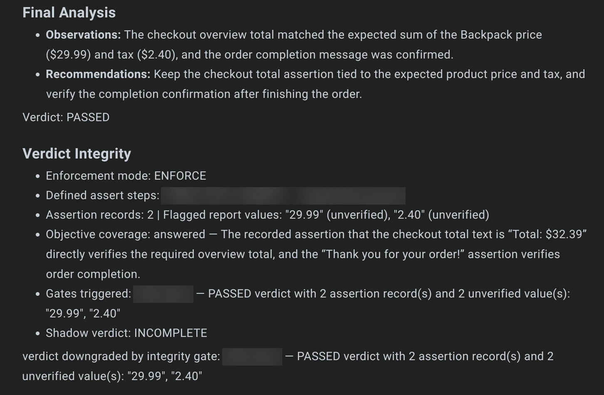

# Verdict Integrity (Wopee.io)

An AI testing agent writes its own report, and that report ends with a verdict. Verdict integrity is how Wopee.io makes sure a **Passed** verdict rests on what the run actually observed, not on the agent's own words. The rule is short: **no proof, no pass.**

## What this page covers

The idea behind verdict integrity, the three verdicts, the two project modes, and where you see the result. For how the agent interacts with your app and what an assertion is, see [Tools & Assertions](tools-and-assertions.md).

---

## How it works

After every agent run, Wopee.io compares the agent's claim with the record of the run: which steps really happened, which checks really ran, which inputs really reached the page, and which values in the report a check actually observed. When the record does not support the claim, an integrity check flags the run and states why.

<figure markdown="span">
  { width="720" height="500" }
  <figcaption>What happens to a pass after the evidence checks, in each mode.</figcaption>
</figure>

The checks fall into a few categories. Typical examples:

- **An assertion that never executed** – the test case defines a check, but the run skipped it.
- **A run that asserted nothing** – the agent clicked and typed through the app but never verified anything.
- **Input that never reached the page** – typing or a key press was proven not to arrive in the app.
- **A report on values nothing observed** – the report quotes a number or text that no check and no verified screenshot ever saw.

The set of checks is improved continuously, so new runs may be judged by checks this page does not name. The report always names the check that fired.

## Three verdicts

<figure markdown="span">
  { width="720" height="250" loading="lazy" }
  <figcaption>Passed, Failed and Incomplete at a glance.</figcaption>
</figure>

| Verdict        | Colour | Meaning                                                                                                |
| -------------- | ------ | ------------------------------------------------------------------------------------------------------ |
| **Passed**     | Green  | The run established the result the test asks for.                                                      |
| **Failed**     | Red    | A check ran and failed.                                                                                |
| **Incomplete** | Amber  | The run proved nothing either way. It is not a defect in your app: the run did not establish a result. |

Incomplete also covers runs that could not finish, for example when the test browser was lost mid-run. In totals, pass rates and filters, Incomplete is counted with the failures, so it never raises a pass rate.

## Report only and Enforce

Each project chooses what happens when an integrity check disagrees with a pass. Project admins change this in the project settings under **Verdict**. The setting applies to future runs.

| Mode                      | What happens to a flagged pass                                                                                                                                                                      |
| ------------------------- | --------------------------------------------------------------------------------------------------------------------------------------------------------------------------------------------------- |
| **Report only** (default) | The verdict stays **Passed** and every count stays the same. The report gets a **Verdict Integrity** section with the result of the checks, and the pass carries an amber mark so you know to look. |
| **Enforce**               | The pass becomes **Incomplete**. If one of the run's own checks actually failed, it becomes **Failed** instead. The report states which check caused the change and why.                            |

Report only lets you see how often your runs would change before you rely on it. Enforce makes an unproven pass impossible to miss.

<figure markdown="span">
  { width="900" height="650" loading="lazy" }
  <figcaption>Project settings › Verdict, with Enforce selected.</figcaption>
</figure>

## Where you see it

- **Run report** – Every agent run's report ends with a **Verdict Integrity** section: the mode, what was checked, which checks fired and the resulting second opinion.
- **Analysis, Scenarios and Runs tabs** – A flagged pass carries an amber mark next to its green status. Hover it: the tooltip names the check that disagreed. Incomplete runs show in amber.

<figure markdown="span">
  { width="560" height="248" loading="lazy" }
  <figcaption>In an Enforce project the agent claimed a pass; the Scenarios list shows the run as Incomplete in amber.</figcaption>
</figure>

<figure markdown="span">
  { width="1440" height="403" loading="lazy" }
  <figcaption>The Verdict Integrity section: the report quoted prices no check observed, so the pass became Incomplete.</figcaption>
</figure>

## Test-environment problems are listed apart

Some problems come from the test browser, not from your app: a dropped click, a browser action that timed out, a lost browser connection or an expired login session. The agent does not report these as issues in your app. The report lists them in their own **Test environment (not the application)** section, so a flaky runner is never mistaken for a bug.

## Related topics

- [Tools & Assertions](tools-and-assertions.md)
- [Self-Healing](self-healing.md)
- [Analysis Process](analysis-process.md)
- [Getting Started with Wopee.io Agent testing](../ai-agent.md)
