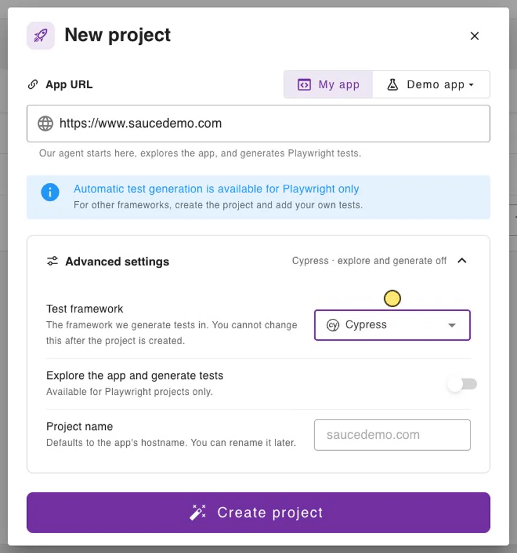

# Cypress

Add visual checks to your existing Cypress tests with the `@wopee-io/wopee.cy` plugin. Each `cy.wopeeTrack()` sends a screenshot to Wopee.io, which compares it with the approved baseline. You review the differences in Commander and approve or reject them.

This page walks through a complete example on [Sauce Demo](https://www.saucedemo.com){: target="\_blank"}: two screenshots, a first run that creates the baselines, and a second run that catches a visual bug. Verified with `@wopee-io/wopee.cy` 4.13.1 and Cypress 16.2.0. Prefer a ready project? Start from the [template project](02-template-project.md).

## Prerequisites

- **Cypress 13 to 16**, with `@wopee-io/wopee.cy` 4.13.1 or newer (4.12.2 and older work with Cypress 13 and 14 only)
- The Node.js version your Cypress needs: 22 or 24 for Cypress 16, 20 or newer for Cypress 13 to 15
- A Wopee.io account at [cmd.wopee.io](https://cmd.wopee.io){: target="\_blank"}

## 1. Create a project

1. In Commander, click **NEW PROJECT** and paste the **App URL** (for example `https://www.saucedemo.com`).
2. Open **Advanced settings** and set **Test framework** to **Cypress**. **Explore the app and generate tests** switches off, because test generation is available for Playwright only.
3. Click **Create project**.

{ width="440" }

## 2. Get the API key

1. In the project, open **More** › **Settings** › **API Keys** and copy `WOPEE_PROJECT_UUID`.
2. Enter a name, click **Generate a new key** and copy `WOPEE_API_KEY`. The key is shown **only once**.

{ width="600" }

## 3. Install

In a new folder (skip `npm init` in an existing project):

```shell
npm init -y
npm install -D cypress@16.2.0 @wopee-io/wopee.cy dotenv
```

Create a `.env` file in the project root:

```shell
WOPEE_PROJECT_UUID=your-project-uuid
WOPEE_API_KEY=your-api-key
```

`WOPEE_API_URL` is needed only for a self-hosted instance (its URL is shown in **API Keys**); the plugin defaults to `https://api.wopee.io`. Add `.env` to `.gitignore`. In CI, set the same variables as secrets; values already set in the environment take precedence over `.env`.

## 4. Register the plugin

The plugin reads its settings from the `wopee` object in `env`, not from the `WOPEE_*` variables directly. Map them in the Cypress config:

```javascript title="cypress.config.js"
require("dotenv").config();
const { defineConfig } = require("cypress");
const { addWopeePlugin } = require("@wopee-io/wopee.cy");

module.exports = defineConfig({
  viewportWidth: 1280,
  viewportHeight: 800,
  env: {
    wopee: {
      apiUrl: process.env.WOPEE_API_URL,
      apiKey: process.env.WOPEE_API_KEY,
      projectUuid: process.env.WOPEE_PROJECT_UUID,
    },
  },
  e2e: {
    baseUrl: "https://www.saucedemo.com",
    setupNodeEvents(on, config) {
      addWopeePlugin(on, config);
    },
  },
});
```

For a TypeScript config (`cypress.config.ts`) use `import "dotenv/config";` and `import { addWopeePlugin } from "@wopee-io/wopee.cy";`. More options of the `wopee` object are in the [plugin reference](03-install-plugin.md#configuration).

## 5. Register the commands

```javascript title="cypress/support/e2e.js"
import { addWopeeCommands } from "@wopee-io/wopee.cy";

addWopeeCommands();
```

## 6. Wait until the page is ready

Cypress takes the screenshot immediately. Web fonts and images that are still loading are missing from the screenshot, and a baseline without text or pictures is worse than none. `document.fonts.status` does not help: it reports `loaded` while the font faces the page uses are still `unloaded`.

Add a `pageReady` command to the same support file. It forces every font face to load and every image to decode:

```javascript title="cypress/support/e2e.js"
import { addWopeeCommands } from "@wopee-io/wopee.cy";

addWopeeCommands();

// Cypress screenshots right away: load web fonts and images first, or the baseline misses text and pictures.
Cypress.Commands.add("pageReady", () =>
  cy.document().then((doc) =>
    Promise.all([
      ...[...doc.fonts].map((font) => font.load()),
      ...[...doc.images].map((img) => img.decode().catch(() => {})),
    ]),
  ),
);
```

Call `cy.pageReady()` before **every** `cy.wopeeTrack()`.

## 7. Track screenshots in your test

```javascript title="cypress/e2e/saucedemo.cy.js"
/// <reference types="cypress" />
/// <reference types="@wopee-io/wopee.cy" />

const pad = (n) => String(n).padStart(2, "0");
const now = new Date();
const stamp = `${now.getFullYear()}-${pad(now.getMonth() + 1)}-${pad(now.getDate())} ${pad(now.getHours())}:${pad(now.getMinutes())}`;
const suiteName = `Cypress demo ${stamp}`;

describe(suiteName, () => {
  before(() => cy.wopeeStartSuite(suiteName));
  beforeEach(() => cy.wopeeStartScenario("Cypress: login and products"));
  afterEach(() => cy.wopeeStopScenario());

  it("login and products", () => {
    cy.visit("/");
    cy.pageReady();
    cy.wopeeTrack({ stepName: "Login page" });

    cy.get("[data-test=username]").type(Cypress.expose("SAUCE_USER") || "standard_user");
    cy.get("[data-test=password]").type("secret_sauce");
    cy.get("[data-test=login-button]").click();
    cy.get(".inventory_list").should("be.visible");
    cy.pageReady();
    cy.wopeeTrack({ stepName: "Products" });
  });
});
```

| Command | Where | Purpose |
| --- | --- | --- |
| `cy.wopeeStartSuite(name)` | `before` | Starts a suite (one entry in **Runs**). Required before the first track. A suite with the same name and branch is reused, so the timestamp gives every run its own entry. |
| `cy.wopeeStartScenario(name)` | `beforeEach` | Starts a scenario. Use a stable name; it is part of the baseline key. |
| `cy.wopeeTrack({ stepName })` | in the test | Takes a full-page screenshot and compares it with the baseline. Chained after `cy.get()` it captures one element. |
| `cy.wopeeStopScenario()` | `afterEach` | Closes the scenario. |

## 8. First run: create the baselines

```shell
npx cypress run
```

```text
[wopee]: Suite(name=Cypress demo 2026-10-12 21:21, uuid=...) is activated.
[wopee]: Scenario(name=Cypress: login and products, uuid=...) is started.
[wopee]: Tracking response: {"stepName":"Login page","imageUrl":"https://cmd.wopee.io/tests?...&tab=RUNS","status":"new"}
[wopee]: Tracking response: {"stepName":"Products","imageUrl":"https://cmd.wopee.io/tests?...&tab=RUNS","status":"new"}
[wopee]: Scenario(name=Cypress: login and products, uuid=...) is stopped.
    ✓ login and products (7250ms)
```

Both steps are `new`: there is no baseline yet. Each `imageUrl` opens the step in Commander. The plugin deletes the local screenshots after the upload.

## 9. Approve in Runs

Open the project and go to **Runs**. Select the run `Cypress demo ...`, then each step, and click **Approve**. The screenshot becomes the baseline.


## 10. Second run: catch a visual bug

Sauce Demo has a `visual_user` whose products page is visually broken. Run the same test as that user:

```shell
npx cypress run --expose SAUCE_USER=visual_user
```

`Cypress.expose()` and `--expose` exist since Cypress 15.10. On older Cypress, read the user with `Cypress.env("SAUCE_USER")` in the test and run `CYPRESS_SAUCE_USER=visual_user npx cypress run`.

```text
[wopee]: Tracking response: {"stepName":"Login page",...,"status":"ok"}
[wopee]: Tracking response: {"stepName":"Products",...,"status":"unresolved"}
[wopee]: Tracking response: {"stepName":"Products",...,"status":"unresolved"}
[wopee]: Tracking response: {"stepName":"Products",...,"status":"unresolved"}
    ✓ login and products (6475ms)
```

**Login page** matches the baseline. **Products** is `unresolved`. The plugin tracks an `unresolved` step up to three times (the first attempt plus two retries) in case the page was still changing, so the line appears three times. Open the step in **Runs**, inspect the highlighted differences and **Reject** it as a bug, or **Approve** it if the change is intended.


## Good to know

- **A difference does not fail the test.** The Cypress run stays green and the step waits for review in Commander. To act on the result in the test, pass a callback: `cy.wopeeTrack({ stepName: "Products" }, (result) => { /* result.status */ })`.
- **Baselines** are identified by `<scenario name>-<step name>` plus the branch and the environment labels. Keep both names stable between runs.
- **Branches**: set `branchName` in the `wopee` object (default `master`), for example from `process.env.WOPEE_BRANCH_NAME`. See [Baselines and branches](../visual-testing.md#baselines-and-branches).
- **Statuses**: `new`, `ok`, `unresolved`, `autoApproved`. See [How it works](../visual-testing.md#how-it-works).
- All commands, options and more examples: [plugin reference](03-install-plugin.md).

## Troubleshooting

| Message | Fix |
| --- | --- |
| `Class extends value undefined is not a constructor or null` (in `agent-base` / `http-proxy-agent`) | Cypress 15 or newer with `@wopee-io/wopee.cy` 4.12.2 or older. Update the plugin: `npm install -D @wopee-io/wopee.cy@latest`. |
| `Cypress.env() was removed in Cypress version 16.0.0` | Your own test code calls `Cypress.env()`. Use `Cypress.expose()` for values the test reads, see [step 10](#10-second-run-catch-a-visual-bug). If the message comes from `cy.wopeeTrack()`, update the plugin to 4.13.1 or newer. |
| `Cannot find module '.../Cypress.app/Contents/MacOS/Contents/Resources/app/index.js'` or `bad option: --no-sandbox` | Cypress was started from a terminal inside VS Code (or another Electron app) that exports `ELECTRON_RUN_AS_NODE=1`. Start it with `env -u ELECTRON_RUN_AS_NODE npx cypress run`, or use another terminal. |
| Fonts or product images are missing in the screenshots | Call `cy.pageReady()` before `cy.wopeeTrack()`, see [step 6](#6-wait-until-the-page-is-ready). |
| `apiKey` or `projectUuid` reported missing | `WOPEE_API_KEY` or `WOPEE_PROJECT_UUID` is not set, or the `env.wopee` object is missing in the Cypress config. |
| `There is no Suite and no Scenario started` | Call `cy.wopeeStartSuite()` in `before()`. |
| `cy.wopeeTrack is not a function` | Add `addWopeeCommands()` to `cypress/support/e2e.js`. |
| `Can't run because no spec files were found` | Spec files must match `specPattern`, by default `cypress/e2e/**/*.cy.{js,jsx,ts,tsx}`. |
| All runs end up in one entry in **Runs** | The suite name is constant. Add a timestamp or build ID to it. |
| A step stays `new` on the second run | The step from the first run was not approved, or the scenario or step name changed. |
