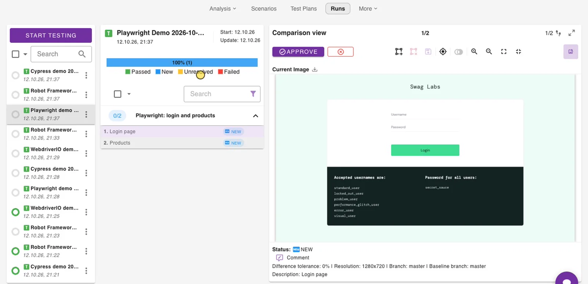

# Cypress template project

When you create a project with the test framework **Cypress**, Wopee.io creates a repository for it from the [Cypress template](https://github.com/Wopee-io/cypress-template){: target="\_blank"} and fills in your project settings. It is a ready Cypress 16 setup with the Wopee.io plugin, the same plugin setup as [Getting started](01-getting-started.md), and one sample test.

| File | What it does |
| --- | --- |
| `cypress.config.ts` | Registers the plugin and maps the `WOPEE_*` variables into `env.wopee`. `baseUrl` is `WOPEE_PROJECT_URL`, the App URL of your project (fallback `https://dronjo.wopee.io/`). |
| `cypress/e2e/simple.spec.cy.ts` | The sample test **Home page works**: opens your app, waits for its fonts and images, and tracks one screenshot, the step **Home page**. |
| `cypress/e2e-examples/` | More examples on the Wopee.io demo app. Not part of the default run; copy a file into `cypress/e2e/` to try it. |
| `.env.example` | Your project's values for local runs. Only `WOPEE_API_KEY` is empty. |
| `.github/workflows/tests.yml` | The workflow Commander starts. |

## Run from Commander

Nothing to set up. In Commander open **Runs** › **Start testing**. Commander runs the repository's tests in GitHub Actions with your project settings and shows the results under **Runs**.

The tests run in Chrome for Testing. To use another browser, set `WOPEE_CYPRESS_BROWSER` in Commander › **More** › **Settings** › **Environment Variables** to a browser name from `npx cypress info`; `electron` keeps the browser Cypress picks by default. A repository on a Cypress older than 13.17.0 runs in Electron.

The workflow has no manual **Run workflow** button in GitHub and does not run on push. To run the tests on every push or pull request, add your own trigger to `.github/workflows/tests.yml`.

## Run locally

Needs [Node.js](https://nodejs.org/en/download/){: target="\_blank"} 22 or 24 (the versions Cypress 16 supports) and git.

```shell
git clone <your project's repository>
cd <repository folder>
cp .env.example .env
```

Open `.env` and paste an API key after `WOPEE_API_KEY=`. Create the key in Commander › **More** › **Settings** › **API Keys**; it is shown only once (see [Get the API key](../visual-testing.md#2-get-the-api-key)). The other values are already your project's. `.env` is in `.gitignore`; do not commit it.

```shell
npm ci
npm test
```

The first `npm ci` also downloads the Cypress app. `npm test` runs `cypress/e2e/**/*.spec.cy.ts` and prints one `[wopee]: Tracking response:` line per tracked step, with its status and a link to the step in Commander.

`npm test` runs in Electron, which Cypress 16 deprecates. `npm test -- --browser chrome` runs in your installed Chrome, closer to the browser Commander uses.

`WOPEE_API_URL` is not needed for [cmd.wopee.io](https://cmd.wopee.io){: target="\_blank"}; the plugin defaults to `https://api.wopee.io`. Set it only for a self-hosted instance.

In a VS Code terminal, start the tests with `env -u ELECTRON_RUN_AS_NODE npm test` (see [Troubleshooting](01-getting-started.md#troubleshooting)).

## Review the results

Open **Runs** in Commander and select the suite **First tests for your project w. Wopee.io** followed by the date and time of the run. The sample puts the date and time into the suite name, so every run is its own entry.

- First run: the step **Home page** is `new`. Check the screenshot and click **Approve**; it becomes the baseline.
- Next runs: the step is `ok` when the page looks the same, or `unresolved` when it differs. Open it, then **Approve** it as the new baseline or **Reject** it as a bug.

A visual difference is reported in Commander; it does not fail the Cypress test. See [Review in Runs](../visual-testing.md#3-review-in-runs).

{ width="1600" height="775" }

## Local runs and Commander baselines

Compare like with like. A screenshot from your machine differs from one taken by Commander's runner: on a Mac with a retina screen the local screenshot is 2560x1440, the runner's is 1280x720, and fonts render differently. A local run against a baseline approved from Commander is therefore `unresolved`. Keep the baselines from one place, usually Commander, and do not approve local screenshots over them.

Commander used to run Cypress tests in Electron. Chrome renders fonts slightly differently, so the first run in Chrome for Testing is `unresolved` on every step whose baseline came from Electron. Check the differences, approve once, and the next runs are `ok`.

For small rendering differences between runs on the same machine, set a tolerance: `WOPEE_PIXEL_TO_PIXEL_DIFF_TOLERANCE` is the difference in percent that still counts as a match. The template passes it to the plugin; set it in `.env` or in Commander › **More** › **Settings** › **Environment Variables**.

## Make it yours

- **Your app:** `cy.visit("/")` opens `baseUrl`, which is `WOPEE_PROJECT_URL`. For local runs change it in `.env`; for runs from Commander change the App URL of the project in Commander.
- **More checks:** add `cy.wopeeTrack({ stepName: "Contact page" })` after an interaction. Every `stepName` gets its own baseline. On a newly loaded page, put the font and image wait from the sample before the track, or use `cy.pageReady()` from [Wait until the page is ready](01-getting-started.md#6-wait-until-the-page-is-ready).
- **More tests:** add `*.spec.cy.ts` files under `cypress/e2e/`. Every test needs what the sample has: start a suite and a scenario, track, stop the scenario.
- **Cypress version:** repositories created before the template moved to Cypress 16 stay on Cypress 13 and keep working. To move one to Cypress 16, run `npm install -D cypress@16 @wopee-io/wopee.cy@latest` and replace any `Cypress.env()` in your tests with `cy.env()`, for example `cy.env(["SAUCE_USER"]).then(({ SAUCE_USER }) => …)`. Variables set in Commander › **Environment Variables** reach the run as `CYPRESS_*` environment variables, which `cy.env()` reads and `Cypress.expose()` does not.

## Cloned the public template?

If `.env` contains `put-your-project-uuid-here`, you cloned the public template, not your project's repository. Put in your project UUID from **More** › **Settings** › **API Keys** (`WOPEE_PROJECT_UUID`) and your app's URL (`WOPEE_PROJECT_URL`), then run as in [Run locally](#run-locally).
