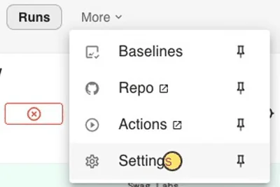
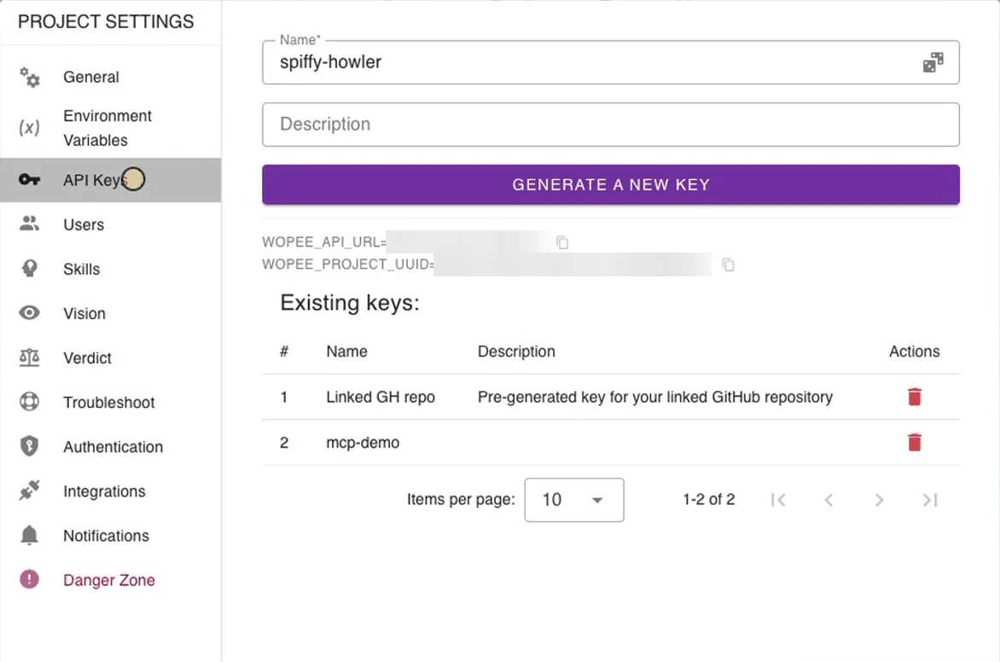
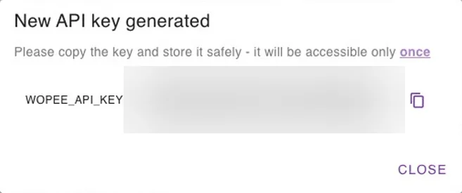

# Find your API key and project UUID

The Wopee.io MCP server, the CI integrations and the visual testing plugins all need two values from your project: `WOPEE_PROJECT_UUID` and `WOPEE_API_KEY`. Both are on the **API Keys** screen of the project in Commander.

## Before you start

- A Wopee.io project. No account yet? Start at [cmd.wopee.io](https://cmd.wopee.io){: target="\_blank"}, see [Getting started](../ai-agent.md).
- **Project admin rights.** Only project admins see **API Keys**. If it is missing from **Settings**, ask a project admin to generate the key for you.

## Copy the project UUID

1. In [Commander](https://cmd.wopee.io){: target="\_blank"}, open your project and go to **More** › **Settings** › **API Keys**.

    { width="300" height="200" }

2. Copy `WOPEE_PROJECT_UUID` with its copy button. The UUID is not a secret.

    { width="600" height="397" loading="lazy" }

The same screen shows `WOPEE_API_URL`. You need it only for a dedicated or self-hosted Wopee.io instance; otherwise leave it out of your configuration.

## Generate an API key

1. On the same screen, enter a name that says where the key is used, for example `Claude Code on my laptop` or `GitHub Actions`.
2. Click **Generate a new key** and copy `WOPEE_API_KEY`.

    { width="440" height="184" loading="lazy" }

The key is shown **only once**. If you lose it, generate a new one.

## Keep the key safe

- **It acts as you.** The key works for this one project, with the rights of the user who created it. Runs started with it count toward that user's plan.
- **Keep it out of chats and committed files.** Put it into your shell environment, a git-ignored `.env` file, your editor's secret prompt or your CI secrets. Coding agents should read it through a reference such as `${WOPEE_API_KEY}`.
- **One key per person and per place.** Each teammate generates their own key, and CI gets its own. You can then delete one without breaking the others.

```shell
export WOPEE_API_KEY="your-api-key"
export WOPEE_PROJECT_UUID="your-project-uuid"
```

On Windows PowerShell use `$env:WOPEE_API_KEY = "your-api-key"`.

## Rotate a key

Rotate a key when it was pasted into a chat, committed, shared or when someone leaves the project:

1. Generate a new key under **More** › **Settings** › **API Keys**.
2. Replace the old value everywhere it is used: your environment, `.env`, CI secrets.
3. Delete the old key under **Existing keys**.

## Next

- [Set up Wopee.io with your coding agent](../agent-setup/index.md)
- [Wopee.io MCP server](wopee-mcp/index.md)
- [Run in CI](../ci/index.md)
