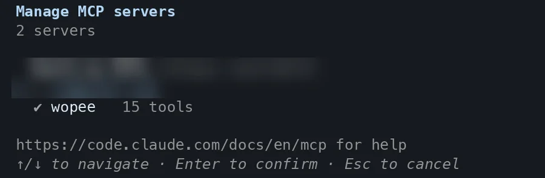
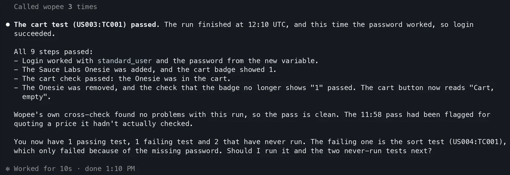

# Add the Wopee.io MCP server to Claude Code

Connect Claude Code to your Wopee.io project, so it can generate tests, run them with Wopee.io's testing agent and read the verdicts. What the server does and how runs work: [Wopee.io MCP server](index.md).

Before you start: Node.js 20.18 or newer, and `WOPEE_API_KEY` and `WOPEE_PROJECT_UUID` from **More** › **Settings** › **API Keys** in your project ([how](index.md#1-get-your-api-key-and-project-uuid)).

Tested on 27 October 2026 with `wopee-mcp` 1.32.0 and the setup on this page.

## Add with the Claude Code CLI

Export the two values in your shell, then add the server from your repository root:

```shell
export WOPEE_API_KEY="your-api-key"
export WOPEE_PROJECT_UUID="your-project-uuid"

claude mcp add --scope project wopee -e 'WOPEE_API_KEY=${WOPEE_API_KEY}' -e 'WOPEE_PROJECT_UUID=${WOPEE_PROJECT_UUID}' -- npx -y wopee-mcp
```

Keep the single quotes: they write the `${...}` references into the config instead of the key itself. Everything after `--` is the command that starts the server.

The command creates `.mcp.json` in the repository root:

```json title=".mcp.json"
{
  "mcpServers": {
    "wopee": {
      "type": "stdio",
      "command": "npx",
      "args": ["-y", "wopee-mcp"],
      "env": {
        "WOPEE_API_KEY": "${WOPEE_API_KEY}",
        "WOPEE_PROJECT_UUID": "${WOPEE_PROJECT_UUID}"
      }
    }
  }
}
```

You can also write this file by hand. Commit it: it contains no secrets, and teammates who set the two variables get the same server.

The first time Claude Code starts in the repository, it asks whether to use the project's new MCP server. Choose **Use this MCP server**.

## Claude Code MCP config file location

| Scope | Flag | File | Use for |
| --- | --- | --- | --- |
| Project | `--scope project` | `.mcp.json` in the repository root | Sharing with the team through git |
| Local (default) | `--scope local` | `~/.claude.json`, under the current project | Only you, only this repository |
| User | `--scope user` | `~/.claude.json` | Only you, every repository |

If the same server name exists in several scopes, local wins over project, and project over user.

## Pass your Wopee.io API key securely

Claude Code replaces `${VAR}` and `${VAR:-default}` in `.mcp.json` with values from the environment it was started from. It does not read `.env` files. If you keep the values in `.env`, load them into the shell before you start Claude Code:

```shell
set -a; source .env; set +a
claude
```

Do not put the key itself into `.mcp.json`. For the local or user scope, where the config is not committed, you can pass the value directly (`-e WOPEE_API_KEY=your-api-key`), but the environment-variable form works the same everywhere.

## Verify the Wopee.io MCP server is connected

```shell
claude mcp list
claude mcp get wopee
```

`claude mcp list` shows `wopee` as **✔ Connected**. Inside a session, run `/mcp`: the list shows **wopee · 15 tools**. The server's three prompts appear as slash commands: `/mcp__wopee__fetch-project-summary`, `/mcp__wopee__fetch-test-results` and `/mcp__wopee__run-test`.

{ width="600" height="197" }

## First prompt to try

```text
How many tests do I have in Wopee.io, and which ones have never run?
```

Claude Code asks to use `wopee_fetch_test_inventory`, then lists the analyses and test cases in your project with their latest status. More prompts: [Prompt library](index.md#prompt-library).

{ width="1400" height="482" loading="lazy" }

In headless mode (`claude -p`), Claude Code loads the project's MCP servers without the approval prompt, but each tool still needs permission. Allow the server's tools with `--allowedTools "mcp__wopee"`:

```shell
claude -p "How many tests do I have in Wopee.io?" --allowedTools "mcp__wopee"
```

## Watch it done

<div class="yt-facade"><a href="https://youtu.be/rIfLyNvAOjs" data-yt="rIfLyNvAOjs" data-title="Claude Code uses the Wopee.io MCP server"><span class="yt-facade__play">Play: Claude Code uses the Wopee.io MCP server</span></a></div>

Claude Code uses the Wopee.io MCP server.
{ .wo-video-caption }

## Several Wopee.io projects

Add one server per project with its own variables, for example:

```shell
claude mcp add --scope project wopee-shop -e 'WOPEE_API_KEY=${WOPEE_SHOP_API_KEY}' -e 'WOPEE_PROJECT_UUID=${WOPEE_SHOP_PROJECT_UUID}' -- npx -y wopee-mcp
claude mcp add --scope project wopee-admin -e 'WOPEE_API_KEY=${WOPEE_ADMIN_API_KEY}' -e 'WOPEE_PROJECT_UUID=${WOPEE_ADMIN_PROJECT_UUID}' -- npx -y wopee-mcp
```

Then name the server in your prompt: "Use wopee-admin to run the login test".

## Troubleshooting

| Problem | Fix |
| --- | --- |
| `[AUTH_ERROR] WOPEE_API_KEY or WOPEE_AUTH_TOKEN must be set` | Claude Code was started from a shell without the variables. Export them (or `source .env` as above) and start `claude` again |
| `claude mcp list` shows **✘ Failed** | Run `npx -y wopee-mcp` in the same shell to see the error. Usually Node.js is older than 20.18 or `npx` is not on the `PATH` |
| The server is missing in `/mcp` | You declined the project server on first start. Run `claude mcp reset-project-choices` and start again |
| `-e` swallowed the server name | Put the name before the `-e` options, as in the command above |
| Answers stop before the verdict | Runs take minutes. Ask "Check the Wopee.io run again" |

All error messages and their fixes: [Troubleshooting](index.md#troubleshooting).

## FAQ

### How do I add an MCP server to Claude Code?

With `claude mcp add <name> -- <command>`, or by adding it to `.mcp.json`. For Wopee.io, use the command at the top of this page.

### Where is the Claude Code MCP config file?

`.mcp.json` in the repository root for the project scope, and `~/.claude.json` for the local and user scopes.

### Can Claude Code run end-to-end tests with MCP?

Yes. With the Wopee.io MCP server, Claude Code starts Wopee.io's testing agent on your test cases, waits for the verdicts and reads the agent's report. The browsers run in the cloud, not on your machine.
