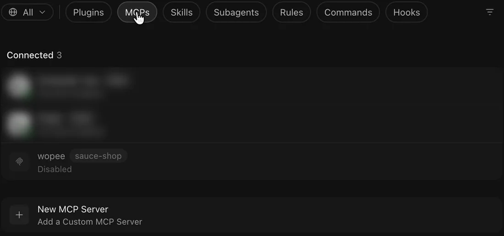
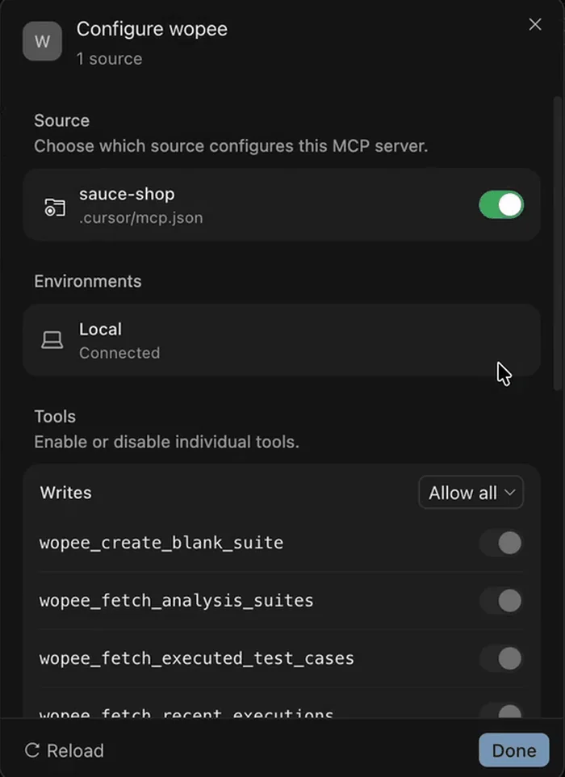
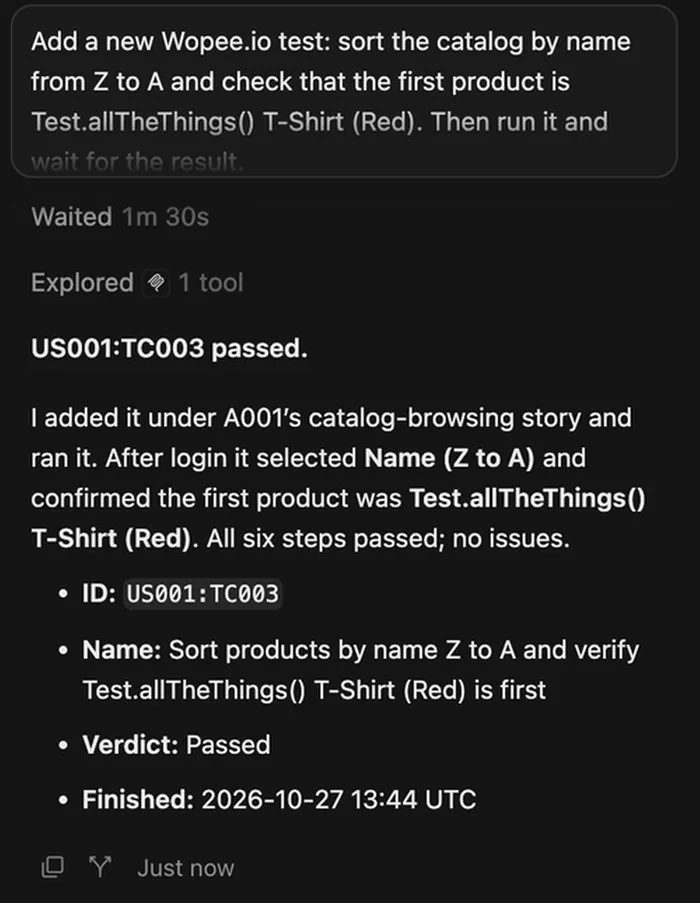

# Add the Wopee.io MCP server to Cursor

Connect Cursor to your Wopee.io project, so its agent can generate tests, run them with Wopee.io's testing agent and read the verdicts. The same configuration works in the Cursor editor and the Cursor CLI (`agent`). What the server does: [Wopee.io MCP server](index.md).

Before you start: Node.js 20.18 or newer, and `WOPEE_API_KEY` and `WOPEE_PROJECT_UUID` from **More** › **Settings** › **API Keys** in your project ([how](index.md#1-get-your-api-key-and-project-uuid)).

Tested on 27 October 2026 with `wopee-mcp` 1.32.0 and Cursor 3.15 using `${env:...}`; `envFile` follows Cursor's documented config schema. The install link and the Cursor CLI follow Cursor's documentation.

## Add to .cursor/mcp.json

Create `.cursor/mcp.json` in your project:

```json title=".cursor/mcp.json"
{
  "mcpServers": {
    "wopee": {
      "command": "npx",
      "args": ["-y", "wopee-mcp"],
      "envFile": "${workspaceFolder}/.env"
    }
  }
}
```

Put the two values into `.env` in the project root and add `.env` to `.gitignore`:

```text title=".env"
WOPEE_API_KEY=your-api-key
WOPEE_PROJECT_UUID=your-project-uuid
```

The config file contains no secrets, so you can commit it for your team. For a dedicated or self-hosted Wopee.io instance, also add `WOPEE_API_URL` to `.env`.

## Pass your Wopee.io API key from environment variables

Instead of `envFile`, you can reference variables from the environment Cursor was started with:

```json title=".cursor/mcp.json"
{
  "mcpServers": {
    "wopee": {
      "command": "npx",
      "args": ["-y", "wopee-mcp"],
      "env": {
        "WOPEE_API_KEY": "${env:WOPEE_API_KEY}",
        "WOPEE_PROJECT_UUID": "${env:WOPEE_PROJECT_UUID}"
      }
    }
  }
}
```

Cursor must see the exported variables:

- Start Cursor from a shell where they are set:

    ```shell
    export WOPEE_API_KEY="your-api-key"
    export WOPEE_PROJECT_UUID="your-project-uuid"
    cursor .
    ```

- Or put the real values only into your user-level `~/.cursor/mcp.json`, which is not part of any repository. Never commit a file with the key.

For a dedicated or self-hosted instance, also add `"WOPEE_API_URL": "${env:WOPEE_API_URL}"` and set that variable; leave the line out otherwise, because an unset variable becomes an empty string.

## One-click install

[Add to Cursor](cursor://anysphere.cursor-deeplink/mcp/install?name=wopee&config=eyJjb21tYW5kIjoibnB4IiwiYXJncyI6WyIteSIsIndvcGVlLW1jcCJdLCJlbnYiOnsiV09QRUVfQVBJX0tFWSI6IiR7ZW52OldPUEVFX0FQSV9LRVl9IiwiV09QRUVfUFJPSkVDVF9VVUlEIjoiJHtlbnY6V09QRUVfUFJPSkVDVF9VVUlEfSJ9fQ==){ .md-button }

The link opens Cursor and adds a server named `wopee` with the `env` references shown above. If the link does nothing (reported on some Linux desktops), add the configuration by hand.

## Cursor MCP config file location

| Scope | File |
| --- | --- |
| Project | `.cursor/mcp.json` in the project root |
| Global | `~/.cursor/mcp.json` |

The Cursor CLI reads the same files.

## Verify the Wopee.io MCP server is connected

1. Open **Customize** › **MCPs**. A project server first shows as **Disabled**.

    { width="1100" height="515" }

2. Open the `wopee` server and switch on the `.cursor/mcp.json` source. The server lists 15 tools.

    { width="420" height="577" loading="lazy" }

3. If it shows an error, open the **Output** panel (Cmd+Shift+U, Ctrl+Shift+U on Windows and Linux) and select **MCP Logs**.

In the Cursor CLI:

```shell
agent mcp list
agent mcp list-tools wopee
```

## First prompt to try

In the agent chat:

```text
How many tests do I have in Wopee.io, and which ones have never run?
```

Cursor calls `wopee_fetch_test_inventory` and lists the analyses and test cases in your project with their latest status. More prompts: [Prompt library](index.md#prompt-library).

{ width="420" height="542" loading="lazy" }

## Watch it done

<div class="yt-facade"><a href="https://youtu.be/9qk64KKUZJw" data-yt="9qk64KKUZJw" data-title="Build an AI QA agent that reads Jira, runs Playwright, and closes the ticket"><span class="yt-facade__play">Play: AI QA agent in Cursor, 4:36</span></a></div>

An agent in Cursor combines the Wopee.io, Playwright and Atlassian MCP servers to retest a fixed Jira bug and report back. 4:36. [Video page](https://wopee.io/videos/ai-qa-agent-jira-playwright/){: target="\_blank"}
{ .wo-video-caption }

## Troubleshooting

| Problem | Fix |
| --- | --- |
| `[AUTH_ERROR] WOPEE_API_KEY or WOPEE_AUTH_TOKEN must be set` | With `envFile`, check that `.env` is in the project root and holds both values. With `${env:...}`, Cursor does not see the variables; start it from a shell where they are exported (`cursor .`), or keep the values in your user-level `~/.cursor/mcp.json` |
| The server is listed as **Disabled** | Project servers start disabled. Open the server in **Customize** › **MCPs** and switch on the `.cursor/mcp.json` source |
| No server is listed at all | Check that the file is valid JSON under `mcpServers`, then switch the server on in **Customize** › **MCPs** |
| The server shows an error in MCP settings | Check **Output** › **MCP Logs**. Usually Node.js is older than 20.18 or `npx` is not on the `PATH`; use the full path to `npx` in `command` |
| The agent uses a browser tool instead | Name Wopee.io in the prompt, or add a rule in `.cursor/rules` that says when to use Wopee.io |

All error messages and their fixes: [Troubleshooting](index.md#troubleshooting).

## FAQ

### How do I add an MCP server to Cursor?

Add the server to `.cursor/mcp.json` (project) or `~/.cursor/mcp.json` (global) under `mcpServers`, or use an install link. Then switch it on in **Customize** › **MCPs**.

### Where is the Cursor MCP config file?

`.cursor/mcp.json` in the project root and `~/.cursor/mcp.json` in your home folder.

### Can Cursor run end-to-end tests with MCP?

Yes. With the Wopee.io MCP server, Cursor's agent starts Wopee.io's testing agent on your test cases, waits for the verdicts and reads the agent's report. The browsers run in the cloud.
