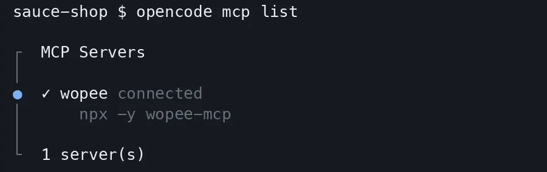
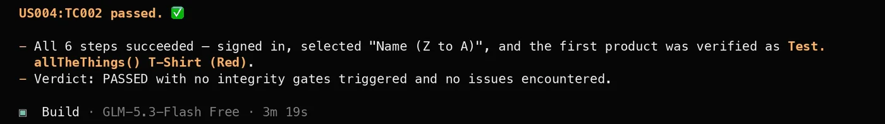

# Add the Wopee.io MCP server to OpenCode

Connect OpenCode to your Wopee.io project, so it can generate tests, run them with Wopee.io's testing agent and read the verdicts from your terminal. What the server does: [Wopee.io MCP server](index.md).

Before you start: Node.js 20.18 or newer, and `WOPEE_API_KEY` and `WOPEE_PROJECT_UUID` from **More** › **Settings** › **API Keys** in your project ([how](index.md#1-get-your-api-key-and-project-uuid)).

Tested on 27 October 2026 with `wopee-mcp` 1.32.0, OpenCode 1.18 and the `opencode.json` setup on this page. OpenCode needs a working model; the free OpenCode models (for example `opencode/glm-5.3-flash-free`) worked in our test.

## Add to opencode.json

Add the server under `mcp` in `opencode.json` in your project root:

```json title="opencode.json"
{
  "$schema": "https://opencode.ai/config.json",
  "mcp": {
    "wopee": {
      "type": "local",
      "command": ["npx", "-y", "wopee-mcp"],
      "enabled": true,
      "environment": {
        "WOPEE_API_KEY": "{env:WOPEE_API_KEY}",
        "WOPEE_PROJECT_UUID": "{env:WOPEE_PROJECT_UUID}"
      }
    }
  }
}
```

OpenCode differs from most clients in three places: the top-level key is `mcp`, `command` is one array that includes the arguments, and variables go under `environment`.

## Add with the OpenCode CLI

```shell
opencode mcp add
```

The command asks for the server details interactively. Use the name `wopee`, a local server and the command `npx -y wopee-mcp`. Then open `opencode.json` and compare the entry with the one above, including the `environment` block.

## OpenCode MCP config file location

| Scope | File |
| --- | --- |
| Project | `opencode.json` in the project root (overrides global) |
| Global | `~/.config/opencode/opencode.json` |
| Custom | the file set in `OPENCODE_CONFIG` |

OpenCode merges these files.

## Pass your Wopee.io API key securely

`{env:WOPEE_API_KEY}` is replaced with the variable from the environment OpenCode runs in. Export the variables before you start `opencode`:

```shell
export WOPEE_API_KEY="your-api-key"
export WOPEE_PROJECT_UUID="your-project-uuid"
opencode
```

`{file:path}` reads the value from a file instead. Do not put the key itself into `opencode.json`.

## Verify the Wopee.io MCP server is connected

```shell
opencode mcp list
```

The output shows `✓ wopee connected`. If it does not, `opencode mcp debug wopee` shows why.

{ width="600" height="189" }

OpenCode prefixes tool names with the server name, so the agent calls the tools as `wopee_wopee_fetch_test_inventory`, `wopee_wopee_dispatch_agent` and so on.

## First prompt to try

```text
How many tests do I have in Wopee.io, and which ones have never run?
```

OpenCode calls `wopee_wopee_fetch_test_inventory` and lists the analyses and test cases in your project with their latest status. More prompts: [Prompt library](index.md#prompt-library).

{ width="1400" height="196" loading="lazy" }

## Troubleshooting

| Problem | Fix |
| --- | --- |
| The config is rejected | `command` must be an array (`["npx", "-y", "wopee-mcp"]`), not a string, and variables go under `environment`, not `env` |
| `[AUTH_ERROR] WOPEE_API_KEY or WOPEE_AUTH_TOKEN must be set` | The variables were not exported in the shell that started `opencode` |
| Tool calls time out | OpenCode waits 30 seconds per call by default. Long generations can take minutes: set `"timeout": 300000` in the `wopee` entry, or ask for `async: true` generation |
| `mcp list` shows `wopee` connected, but the chat does not answer | OpenCode has no working model. Pick one with `/models`; the free OpenCode models work |
| The server takes too much context | Set `"enabled": false` when you do not need it, and enable it per project |

All error messages and their fixes: [Troubleshooting](index.md#troubleshooting).

## FAQ

### How do I add an MCP server to OpenCode?

Add it under `mcp` in `opencode.json` with `"type": "local"` and `command` as an array, or run `opencode mcp add`.

### Where is the OpenCode MCP config file?

`opencode.json` in the project root, and `~/.config/opencode/opencode.json` for all projects.

### Can OpenCode run end-to-end tests with MCP?

Yes. With the Wopee.io MCP server, OpenCode starts Wopee.io's testing agent on your test cases, waits for the verdicts and reads the agent's report. The browsers run in the cloud.
