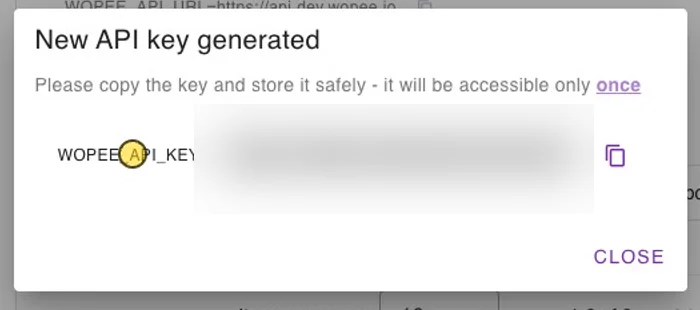

# Visual testing with your own tests

Keep your tests in your framework and add visual checks to them. At the points you choose, your test sends a screenshot to Wopee.io. Wopee.io compares it with the approved baseline, and you approve or reject every difference in [Commander](https://cmd.wopee.io){: target="\_blank"}.

| Framework | Package | Guide |
| --- | --- | --- |
| Playwright | `@wopee-io/wopee.pw` (npm) | [Playwright](playwright-visual-testing.md) |
| Cypress | `@wopee-io/wopee.cy` (npm) | [Cypress](cypress/01-getting-started.md) |
| WebdriverIO | `@wopee-io/wopee.wdio` (npm) | [WebdriverIO](webdriverio-visual-testing.md) |
| Robot Framework | `wopee_rf` (PyPI) | [Robot Framework](robot-framework/01-getting-started.md) |
| Anything else | GraphQL API | [Any other framework](#any-other-framework-graphql-api) |

Every guide uses the same example: log in to [Sauce Demo](https://www.saucedemo.com){: target="\_blank"}, track the **Login page** and the **Products** page, approve both, then run again as `visual_user` to see a real visual difference.

## How it works

Results are organised in three levels:

- **Suite**: one run of your tests. It appears as one entry in **Runs**.
- **Scenario**: usually one test. It groups the screenshots of that test.
- **Step**: one tracked screenshot, compared with its baseline.

A **baseline** is the approved screenshot of a step. It is identified by `<scenario name>-<step name>` together with the **branch** (default `master`) and the optional labels for OS, browser, viewport, device and custom tags. Keep scenario and step names stable between runs: renaming either one starts a new baseline.

A suite is reused when a suite with the same name already exists on the same branch, so the next run adds to the old entry in **Runs**. Put a timestamp or a CI build number into the suite name to get one entry per run.

Each tracked step returns a status:

| Status | Meaning |
| --- | --- |
| `new` | There is no baseline yet. Approve the screenshot to make it the baseline. |
| `ok` | The screenshot matches the baseline. |
| `unresolved` | The screenshot differs from the baseline. Approve it as the new baseline or reject it as a bug. |
| `autoApproved` | Approved automatically, for example when a matching baseline exists on another branch and auto-approve is on. |

After your review, Commander shows the step as **Approved** or **Failed** (rejected).

!!! note "A visual difference never fails your test"

    The test passes even when a step is `unresolved`. You review differences in Commander. To fail the test as well, check the status the track call returns (each guide shows how) or use the framework's soft-assert switch where there is one.

## 1. Create a project

1. In Commander, click **NEW PROJECT** and paste the **App URL**.
2. Open **Advanced settings** and choose the **Test framework**: Playwright, Cypress, Robot Framework or WebdriverIO. You cannot change it after the project is created.
3. Switch off **Explore the app and generate tests**. You bring your own tests, so the AI exploration is not needed. Automatic test generation is available for Playwright only; for the other frameworks the switch is already off.
4. Click **Create project**.

{ width="440" }

{ width="440" }

## 2. Get the API key

1. In the project, open **More** › **Settings** › **API Keys**. The section shows `WOPEE_API_URL` and `WOPEE_PROJECT_UUID`.
2. Enter a name and click **Generate a new key**. The dialog shows `WOPEE_API_KEY` **only once**: copy it right away. If you lose it, generate a new one and delete the old one under **Existing keys**.

{ width="600" }

{ width="420" }

Put the three values into a `.env` file in your test project:

```shell
WOPEE_API_URL=https://api.wopee.io
WOPEE_PROJECT_UUID=your-project-uuid
WOPEE_API_KEY=your-api-key
```

`https://api.wopee.io` is the API of the cloud at `cmd.wopee.io`. Self-hosted instances show their own URL in **API Keys**. Add `.env` to `.gitignore` and never commit the key. In CI, set the same variables as secrets.

## 3. Review in Runs

Open the project and go to **Runs**. Select the run on the left, then a step of the scenario. The **Comparison view** shows the current screenshot; when a baseline exists, the baseline is shown next to it.


- **Approve** makes the screenshot the baseline of the step.
- **Reject** (the red button next to it) marks the screenshot as a bug. The baseline stays as it was.
- To decide many steps at once, select them in the scenario list and approve or reject them together.
- The difference overlay highlights the changed pixels. The line under the image shows the difference in percent, the tolerance, the resolution, the branch and the baseline branch.

On the next run, matching steps are `ok` and changed steps are `unresolved`:


## Baselines and branches

- Set the branch of a run with `WOPEE_BRANCH_NAME` (or the `branchName` option of the plugin). The SDKs default to `master`.
- Approved baselines are listed under **More** › **Baselines**. There you can delete baselines and merge the baselines of one branch into another (**Merge Branches**), for example after a feature branch is merged.
- **Add Baseline** in **More** › **Baselines** defaults to the branch `main`, while the SDKs default to `master`. Use the same branch name in both places, or a baseline you add by hand is never compared with your runs.

## Wait for fonts and images before tracking

A screenshot taken while web fonts or images are still loading shows up as a difference on the next run, or worse, becomes a baseline with missing text and pictures. Wait until the page is complete before each track call:

```javascript
// Runs in the page. Forces every web font to load and every image to decode.
await Promise.all([
  ...[...document.fonts].map((font) => font.load()),
  ...[...document.images].map((img) => img.decode().catch(() => {})),
]);
```

`document.fonts.status` and `document.fonts.ready` are not enough: they can report `loaded` while font faces the page uses are still `unloaded`. Cypress needs this wait explicitly, see [Cypress › Wait until the page is ready](cypress/01-getting-started.md#6-wait-until-the-page-is-ready). In the other frameworks, wait for the content you want to capture (for example the product list) before tracking.

## Any other framework (GraphQL API)

All SDKs talk to the same GraphQL API, so you can send screenshots from any language or tool. There is no separate API reference yet; this section lists the calls the SDKs make.

- **Endpoint**: `POST` to `WOPEE_API_URL` itself (for example `https://api.wopee.io`), with a JSON body `{"query": "...", "variables": {...}}`.
- **Authentication**: the API key in the `api_key` header. Current API versions also accept `x-api-key`, which helps when a proxy drops header names with an underscore. The SDKs send both.

The calls, in order:

| Mutation | Arguments | Returns |
| --- | --- | --- |
| `createIntegrationSuite` | `projectUuid: ID!`, `name: String!`, `suiteIntegrationConfig: { branchName }` | `uuid`, `name` |
| `createIntegrationScenario` | `projectUuid: ID!`, `suiteUuid: ID!`, `name: String` | `uuid`, `name` |
| `createIntegrationStep` | `input: CreateIntegrationStepInput!` (below) | `status`, `url`, `diffPercent`, `branchName`, `baselineBranchName`, … |
| `stopIntegrationScenario` | `scenarioUuid: ID!`, `projectUuid: ID!` | `uuid` |
| `stopIntegrationSuite` | `suiteUuid: ID!` | `uuid` |

`CreateIntegrationStepInput`:

| Field | Required | Description |
| --- | --- | --- |
| `projectUuid` | yes | `WOPEE_PROJECT_UUID` |
| `scenarioUuid` | yes | From `createIntegrationScenario` |
| `stepName` | yes | Step name shown in Commander |
| `trackName` | yes | Baseline key. The SDKs send `<scenario name>-<step name>`; do the same to share baselines with them. |
| `imageBase64` | yes | The screenshot as base64-encoded PNG, without a `data:` prefix |
| `os`, `browser`, `viewport`, `device`, `customTags` | no | Labels that are part of the baseline identity |
| `pixelToPixelDiffTolerance` | no | Difference in percent that still counts as a match |
| `comment` | no | Free text stored with the step |
| `baselineBranchName` | no | Branch to compare with when the current branch has no baseline |

`status` is one of `new`, `ok`, `unresolved`, `autoApproved` (and `approved` or `failed` for a step that was already reviewed). `url` opens the step in Commander.

Example with `curl`, starting a suite on the branch `master`:

```shell
curl -s "$WOPEE_API_URL" \
  -H "Content-Type: application/json" \
  -H "api_key: $WOPEE_API_KEY" \
  -d '{
    "query": "mutation($projectUuid: ID!, $name: String!, $config: SuiteConfigInput) { createIntegrationSuite(projectUuid: $projectUuid, name: $name, suiteIntegrationConfig: $config) { uuid name } }",
    "variables": {
      "projectUuid": "'"$WOPEE_PROJECT_UUID"'",
      "name": "My run 2026-10-12 10:00",
      "config": { "branchName": "master" }
    }
  }'
```

Then create a scenario with the returned suite `uuid`, send one `createIntegrationStep` per screenshot, and stop the scenario and the suite at the end.
