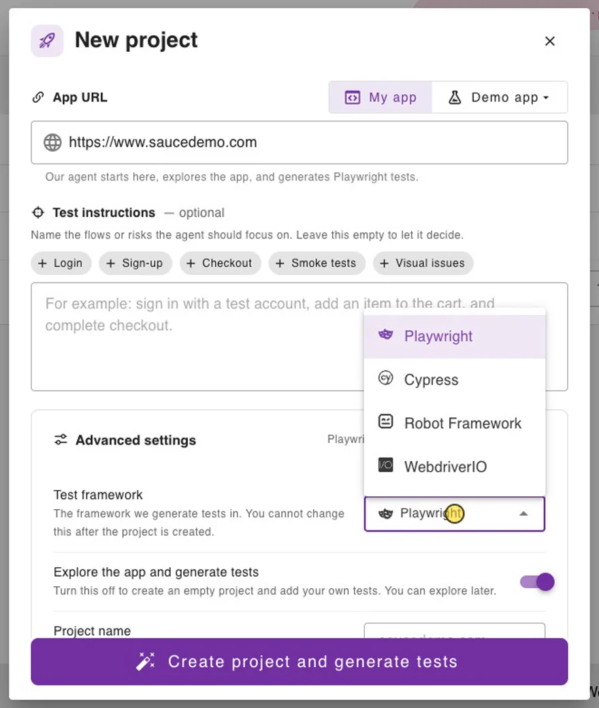
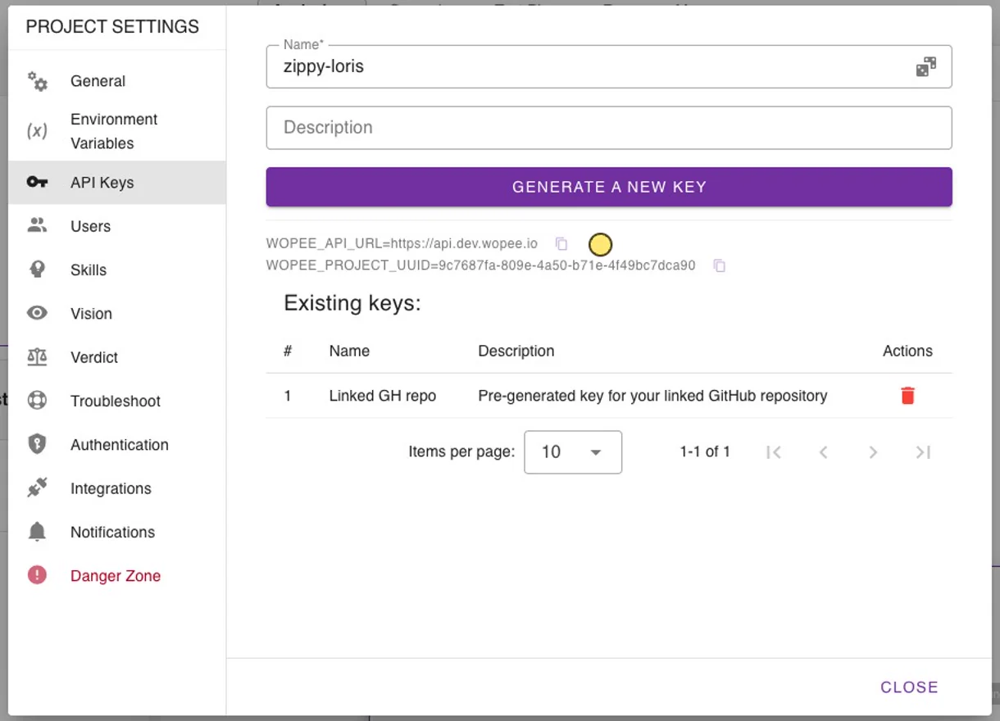
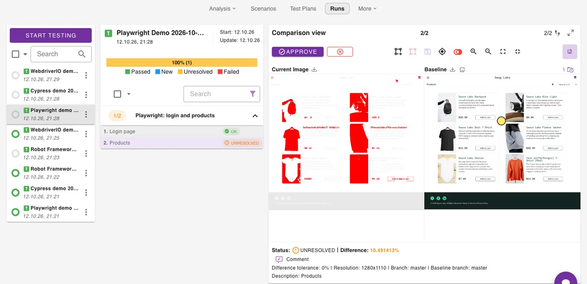

# WebdriverIO

Add visual checks to your existing WebdriverIO tests with the `@wopee-io/wopee.wdio` service. Each `browser.track...()` command sends a screenshot to Wopee.io, which compares it with the approved baseline. You review the differences in Commander and approve or reject them.

This page walks through a complete example on [Sauce Demo](https://www.saucedemo.com){: target="\_blank"}: two screenshots, a first run that creates the baselines, and a second run that catches a visual bug. Verified with `@wopee-io/wopee.wdio` 6.0.0 and WebdriverIO 9 (Mocha, Chrome).

## Prerequisites

- Node.js 20 or newer
- WebdriverIO 9 (or 8) with a test framework such as Mocha. `npm init wdio` sets one up.
- Google Chrome. WebdriverIO 9 downloads the matching ChromeDriver on the first run.
- A Wopee.io account at [cmd.wopee.io](https://cmd.wopee.io){: target="\_blank"}

## 1. Create a project

1. In Commander, click **NEW PROJECT** and paste the **App URL** (for example `https://www.saucedemo.com`).
2. Open **Advanced settings** and set **Test framework** to **WebdriverIO**. **Explore the app and generate tests** switches off, because test generation is available for Playwright only.
3. Click **Create project**.

{ width="440" }

## 2. Get the API key

1. In the project, open **More** › **Settings** › **API Keys** and copy `WOPEE_API_URL` and `WOPEE_PROJECT_UUID`.
2. Enter a name, click **Generate a new key** and copy `WOPEE_API_KEY`. The key is shown **only once**.

{ width="600" }

## 3. Install

```shell
npm install --save-dev @wopee-io/wopee.wdio dotenv
```

`webdriverio` is a peer dependency; projects created with `npm init wdio` already have it.

Create a `.env` file in the project root:

```shell
WOPEE_API_URL=https://api.wopee.io
WOPEE_PROJECT_UUID=your-project-uuid
WOPEE_API_KEY=your-api-key
```

Add `.env` to `.gitignore`. In CI, set the same variables as secrets.

## 4. Configure the service

Load `.env` and add the service to `wdio.conf.ts`:

```typescript title="wdio.conf.ts"
import 'dotenv/config';

export const config: WebdriverIO.Config = {
  // ...your runner, specs, capabilities, framework and reporters
  services: [
    [
      '@wopee-io/wopee.wdio',
      {
        screenshotValidation: {
          apiUrl: process.env.WOPEE_API_URL,
          apiKey: process.env.WOPEE_API_KEY,
          projectUuid: process.env.WOPEE_PROJECT_UUID,
        },
        isLandscape: false,
      },
    ],
  ],
};
```

- The connection settings go **inside** `screenshotValidation`. The service does not pick up `WOPEE_*` variables on its own; pass every value through the config.
- `isLandscape` sits **next to** `screenshotValidation`. Set it to `false` for desktop browsers: the default `true` is meant for mobile devices in landscape orientation and crops desktop screenshots to the wrong size.

For TypeScript, add the service types to `tsconfig.json` so `browser.trackScreen()` and the other commands are typed:

```json title="tsconfig.json"
{
  "compilerOptions": {
    "types": ["node", "@wdio/globals/types", "@wopee-io/wopee.wdio"]
  }
}
```

## 5. Track screenshots in your test

```typescript title="test/specs/saucedemo.visual.ts"
import { browser, $ } from '@wdio/globals';

const user = process.env.SAUCE_USER ?? 'standard_user';

describe('Sauce Demo', () => {
  before(async () => {
    await browser.startSuite(`WebdriverIO demo ${new Date().toISOString().slice(0, 16)}`);
  });

  it('logs in and shows the products', async () => {
    await browser.startScenario('WebdriverIO: login and products');

    await browser.url('https://www.saucedemo.com');
    await $('#login-button').waitForDisplayed();
    await browser.execute(async () => {
      await document.fonts.ready;
    });
    const login = await browser.trackScreen({ stepName: 'Login page' });
    console.log('Login page:', login.screenshotValidationResult);

    await $('#user-name').setValue(user);
    await $('#password').setValue('secret_sauce');
    await $('#login-button').click();
    await $('.inventory_list').waitForDisplayed();
    await browser.execute(async () => {
      await Promise.all([...document.images].map((img) => img.decode().catch(() => {})));
    });

    const products = await browser.trackScreen({ stepName: 'Products' });
    console.log('Products:', products.screenshotValidationResult);

    await browser.stopScenario();
  });
});
```

| Command | Purpose |
| --- | --- |
| `browser.startSuite(name)` | Starts a suite (one entry in **Runs**). Call it once, in `before`. A suite with the same name and branch is reused, so the timestamp gives every run its own entry. |
| `browser.startScenario(name)` | Starts a scenario. Use a stable name; it is part of the baseline key. |
| `browser.trackScreen({ stepName })` | Takes a screenshot of the visible part of the page and compares it with the baseline. |
| `browser.stopScenario()` | Closes the scenario. |

The two `browser.execute()` calls wait for web fonts and for every image to decode before tracking. See [Wait for fonts and images before tracking](visual-testing.md#wait-for-fonts-and-images-before-tracking).

Other track commands:

| Command | Captures |
| --- | --- |
| `browser.trackFullPageScreen({ stepName })` | The whole page, scrolled and stitched |
| `browser.trackElement({ stepName, element })` | One element. In WebdriverIO 9 pass `await $('selector').getElement()`. |
| `browser.trackImage({ stepName, imageBase64 })` | Any PNG you provide as base64, for example from `browser.takeScreenshot()` |

There is no `wopeeTrack` command in WebdriverIO. All track commands accept the optional `comment`, `customTags`, `pixelToPixelDiffTolerance`, `viewport` and `baselineBranchName`, and return `{ screenshotValidationResult: { stepName, imageUrl, status } }`.

## 6. First run: create the baselines

```shell
npx wdio run wdio.conf.ts
```

```text
[0-0] Login page: {
[0-0]   stepName: 'Login page',
[0-0]   imageUrl: 'https://cmd.wopee.io/tests?projectId=...&suiteId=...&stepId=...&tab=RUNS',
[0-0]   status: 'new'
[0-0] }
[0-0] Products: {
[0-0]   stepName: 'Products',
[0-0]   imageUrl: 'https://cmd.wopee.io/tests?projectId=...&suiteId=...&stepId=...&tab=RUNS',
[0-0]   status: 'new'
[0-0] }
[0-0] PASSED in chrome - file:///test/specs/saucedemo.visual.ts
```

Both steps are `new`: there is no baseline yet. Add `--logLevel info` to see when the suite and scenario start and stop.

## 7. Approve in Runs

Open the project and go to **Runs**. Select the run `WebdriverIO demo ...`, then each step, and click **Approve**. The screenshot becomes the baseline.


## 8. Second run: catch a visual bug

Sauce Demo has a `visual_user` whose products page is visually broken. Run the same test as that user:

```shell
SAUCE_USER=visual_user npx wdio run wdio.conf.ts
```

```text
[0-0] Login page: {
[0-0]   stepName: 'Login page',
[0-0]   imageUrl: 'https://cmd.wopee.io/tests?projectId=...&suiteId=...&stepId=...&tab=RUNS',
[0-0]   status: 'ok'
[0-0] }
[0-0] Products: {
[0-0]   stepName: 'Products',
[0-0]   imageUrl: 'https://cmd.wopee.io/tests?projectId=...&suiteId=...&stepId=...&tab=RUNS',
[0-0]   status: 'unresolved'
[0-0] }
[0-0] PASSED in chrome - file:///test/specs/saucedemo.visual.ts
```

**Login page** matches the baseline. **Products** is `unresolved`: open it in **Runs**, inspect the highlighted differences and **Reject** it as a bug, or **Approve** it if the change is intended.



## Good to know

- **A difference does not fail the test.** The test passes and the step waits for review. To fail the test as well, check the returned status:

    ```typescript
    const products = await browser.trackScreen({ stepName: 'Products' });
    expect(products.screenshotValidationResult?.status).not.toBe('unresolved');
    ```

- **Baselines** are identified by `<scenario name>-<step name>` plus the branch and the environment labels. Keep both names stable between runs.
- **Branches**: set `branchName` in `screenshotValidation` (default `master`). See [Branches in CI](#branches-in-ci) and [Baselines and branches](visual-testing.md#baselines-and-branches).
- **Statuses**: `new`, `ok`, `unresolved`, `autoApproved`. See [How it works](visual-testing.md#how-it-works).

## Configuration

Options inside `screenshotValidation`:

| Option | Default | Description |
| --- | --- | --- |
| `apiKey` | required | API key from **More** › **Settings** › **API Keys** |
| `projectUuid` | required | Project UUID from the same page |
| `apiUrl` | `https://api.wopee.io` | API endpoint from the same page |
| `branchName` | `master` | Branch the screenshots belong to |
| `baselineBranchName` | | Branch to compare with when the current branch has no baseline yet |
| `pixelToPixelDiffTolerance` | `0` | Difference in percent that still counts as a match |
| `customTags`, `comment` | | Stored with each step |
| `browser`, `device`, `os`, `viewport` | | Labels that are part of the baseline identity |
| `screenshotValidationEnabled` | `true` | `false` runs the tests without sending screenshots |

Options next to `screenshotValidation`:

| Option | Default | Description |
| --- | --- | --- |
| `isLandscape` | `true` | Set to `false` for desktop browsers |
| `imageProcessing` | `mode: 'none'` | `mode: 'masking'` or `'cropping'` with `xLeft`, `xRight`, `yTop`, `yBottom` and `maskColor` to hide or cut screen edges on every screenshot |

### Branches in CI

```typescript
screenshotValidation: {
  apiUrl: process.env.WOPEE_API_URL,
  apiKey: process.env.WOPEE_API_KEY,
  projectUuid: process.env.WOPEE_PROJECT_UUID,
  branchName: process.env.WOPEE_BRANCH_NAME ?? 'master',
  baselineBranchName: process.env.WOPEE_BASELINE_BRANCH_NAME,
},
```

## Troubleshooting

| Message | Fix |
| --- | --- |
| `Failed to initialise service @wopee-io/wopee.wdio` naming `apiKey` or `projectUuid` | The value is missing. Check `.env`, that `wdio.conf.ts` starts with `import 'dotenv/config'`, and that the values are inside `screenshotValidation`. |
| `must be an absolute URL including the scheme` | Write `apiUrl` with `https://`. |
| `browser.trackScreen is not a function` | The service is not listed in `services`, or the package is not installed. |
| The screenshot is narrow and tall, with a white area | Set `isLandscape: false` next to `screenshotValidation`. |
| A step is `unresolved` on every run without a visible change | The page was still loading. Wait for fonts and images before tracking, or draw an ignore area over the dynamic region in the comparison view. |
| All runs end up in one entry in **Runs** | The suite name is constant. Add a timestamp or build ID to it. |
